# BACS Calendar: specification

**Product:** Mobius PAS · Accounts › BACS › Calendar
**Screen IDs:** CA-FF-SS (flow, screen)
**Status:** Ready for build
**Source of visual truth:** Figma frames in `screenshots/`. Where a screenshot and this spec disagree on data or behaviour, **this spec wins** (see section 12).

---

## 1. Purpose

The Calendar tab is where users choose which days BACS direct debit collections can happen. It replaces Transactor's *Amend BACS Calendar* screen.

Users can:

- set a **collection schedule** (No default, Every working day, or Set days of the month);
- **add or remove single dates** on a month calendar;
- see the **next collection**, the **number of collection days in the month**, and the **current schedule** at a glance.

Collection days set here are the dates offered when creating a BACS run on the Process tab.

## 2. Scope

**In scope**

- Calendar tab layout: page title, three summary cards, month calendar, helper text.
- Month navigation: previous and next arrows, and a month picker popover.
- Five cell states plus a today marker.
- Adding and removing single dates (autosave).
- Collection schedule modal with three options, including the *Set days of the month* multiselect.
- Schedule saved toast with Undo.
- England and Wales bank holidays.
- Shared data store so Process (when built) can read collection days.

**Out of scope**

- Building the Process tab itself (stays a placeholder).
- Per-date passwords from Transactor (see section 14).
- Instalment counts, batch references or any per-day financial detail on the calendar.
- Toasts for single-date changes (deliberately removed, see 9.3).

## 3. Build instructions for Claude Code

### 3.1 Read the Figma, then use Buckholt first

1. **Inspect every screenshot in `screenshots/` before building.** They define layout, spacing, type, colour and component choice.
2. **Use existing Buckholt components wherever one exists.** Match tokens (colour, spacing, radius, type, elevation) through Buckholt's CSS variables, not hard-coded values. Components expected to come from Buckholt:
   - app shell, sidebar, top bar and BACS section tabs (already built for Originators and Import);
   - summary cards;
   - link button with icon (*Change schedule*);
   - modal (header, close ×, footer with Cancel text button and primary button);
   - radio cards (selectable option cards with radio);
   - multiselect with tags (the tag variant, label above, chevron right);
   - toast (success variant, Undo action, **no close button**, as in Originators and Import);
   - icon buttons (chevrons).
3. **The calendar is new to Buckholt.** Nothing in Buckholt covers the month grid, the day cell states or the month picker popover. Build these as a new component.

### 3.2 New `calendar/` component folder

Create a new folder called **`calendar/`** in the Git structure, alongside the existing Buckholt component folders, following the same convention as the other components:

```
calendar/
  calendar.md        Component documentation: anatomy, states, tokens, behaviour, accessibility
  calendar.css       Styles for the month grid, day cells, today marker and month picker
  example.html       Standalone example showing every cell state and the month picker
```

Rules for `calendar.css`:

- Use Buckholt tokens (CSS variables) for every colour, space, radius, font and shadow that has one.
- Where Figma shows a value with no Buckholt token, define it as a **component-scoped variable** at the top of `calendar.css` (for example `--calendar-cell-weekend-bg`) and list it in `calendar.md` under *New values*. Do not scatter raw hex values through the file.
- Prefix all classes with `calendar-` (for example `.calendar-grid`, `.calendar-cell--selected`).
- Must not change the look of any existing component.

### 3.3 Join up with the existing BACS work

- Build Calendar as the **next tab in the same prototype** as Originators and Import, not a separate app.
- Reuse the Originators/Import folder structure, file naming, stack, routing and seed-data pattern.
- Tabs read **Process · Import · Originators · Calendar**. Calendar becomes live. Process stays a placeholder.
- Extend shared components rather than duplicating them. Any change made for Calendar must not break Originators or Import.
- Put calendar data in the shared seed-data location (for example `data/calendar.js`) so Process can read collection days later (section 11.4).
- The top bar date and time come from the same **TODAY** constant as the calendar (section 11.1).

## 4. Page layout

*Reference: CA-00-01.*

Top to bottom, inside the standard BACS page:

1. **Tabs:** Process, Import, Originators, **Calendar** (active).
2. **Page title (H1):** *Choose BACS collection days*.
3. **Summary cards:** three equal cards in a row (section 6).
4. **Month bar:** previous chevron, month and year button (opens month picker), next chevron (section 7).
5. **Calendar grid:** weekday headers then day cells (section 5).
6. **Helper text** below the grid, muted, max width roughly 60% of content:
   > Select a working day to add or remove it as a collection day. Changes save straight away. Dates already sent to Bacs are locked. You can plan up to 24 months ahead.

## 5. Calendar grid

### 5.1 Structure

- Seven columns, Monday first. Headers: **Monday, Tuesday, Wednesday, Thursday, Friday, Sat, Sun**.
- **Weekend columns are narrower** than weekday columns (see Figma; weekdays roughly 3.4× the weekend width).
- Weeks run in rows. Leading and trailing days outside the month are **blank cells**.
- Each cell shows the **date number, zero-padded** (`01`, `02` … `31`) in a small circular badge at top left, and an optional **label** at bottom left.

### 5.2 Cell states

*Reference: CA-03-03 (selected, read-only, disabled), CA-00-01 (default, blank), CA-06-01 (bank holiday).*

| State | When | Interactive | Label | Look (confirm in Figma) |
|---|---|---|---|---|
| **Default** | Future working day, not a collection day, not yet sent to Bacs | Yes | none | White fill, light grey border, heavier grey bottom edge (raised) |
| **Selected** | Future working day that is a collection day, not yet sent | Yes | *Collection day* | Pale blue fill (≈ #E8EDFB), blue border and heavier blue bottom edge (≈ #0F40C5), label in blue |
| **Read-only** | Any date before today, or a date already sent to Bacs | No | *Collected* (past collection day), *Collection day* (today or later, sent), none (past non-collection working day) | White fill, faint border, no raised edge, label in grey |
| **Disabled** | Saturday, Sunday, or bank holiday | No | *Bank holiday* on bank holidays, none on weekends | Grey fill (≈ #EFEFEF), muted date |
| **Blank** | Outside the displayed month | No | none | Very light grey fill (≈ #FBFBFB), no date |

**Today marker:** today's date badge is filled light blue (≈ #B7C6EE). It sits on top of whatever state the cell has (in the seed data, today is read-only *Collection day*). Other date badges are light grey.

**Hover (Default and Selected only):** border turns blue. **Pointer:** `pointer` on interactive cells, `default` elsewhere.

**Focus:** visible keyboard focus ring on interactive cells, at least 3px, offset from the border. Define it in `calendar.css` using the Buckholt focus token if one exists.

### 5.3 Contrast

The Default cell's bottom edge must reach **3:1 against white** (WCAG 1.4.11). If the Figma grey falls short, darken it slightly (around #858B91) and note it in `calendar.md`.

## 6. Summary cards

*Reference: CA-00-01, CA-02-02, CA-03-03.*

| Card | Label | Value | Rule |
|---|---|---|---|
| 1 | Next collection | e.g. *Thursday 15 October* | First collection day **after today**, in any future month. Format `Weekday D Month`, no leading zero, no ordinal. If none: *None set*. |
| 2 | Collection days in {Month} | e.g. *22* | Count of all collection days in the **month currently displayed**: collected, sent and future. `{Month}` follows the month in view (December when viewing December). |
| 3 | Schedule | *No default*, *Every working day* or *Set days of the month* | The saved schedule option. Never changes because of single-date edits. Has the **Change schedule** link button (icon + text) at top right, which opens the schedule modal. |

Cards update immediately after any change.

## 7. Month navigation

*Reference: CA-00-01, CA-01-01.*

- **Previous / next chevrons** move one month. Disable a chevron at the end of the range.
- **Month button** shows *Month YYYY* (e.g. *October 2026*). Clicking it opens the **month picker** popover below it; the button shows its active (filled) state while open.
- **Month picker:**
  - Year header with previous and next year chevrons.
  - 3 × 4 grid of month buttons (*Jan … Dec*).
  - Displayed month is highlighted (blue outline, pale blue fill).
  - **Proposed (not in Figma):** months outside the navigable range are disabled; year chevrons disable at range ends.
  - **Current month** text link at bottom right jumps to the month containing today and closes the popover.
  - Selecting a month closes the popover and shows that month.
  - Closes on Escape, on click outside, and returns focus to the month button.
- **Range:** from **July 2026** (start of seed history, *Assumption*) to **24 months after the current month** (October 2028 with the seed date).

## 8. Flows

### CA-00 Calendar overview

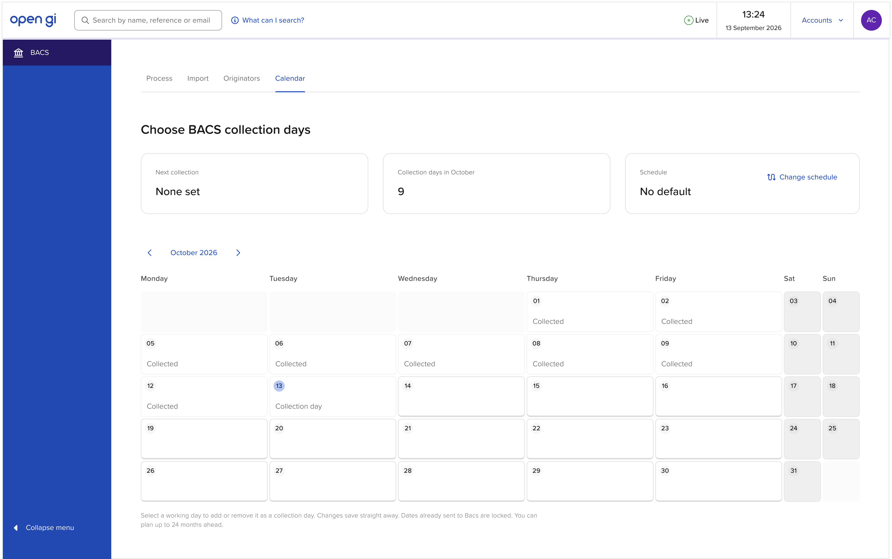
*CA-00-01: Calendar tab on first load. Schedule is No default, so no future dates are collection days.*

- Opens on the month containing today.
- Seed starting state: schedule **No default**, no single-date changes.

### CA-01 Month navigation

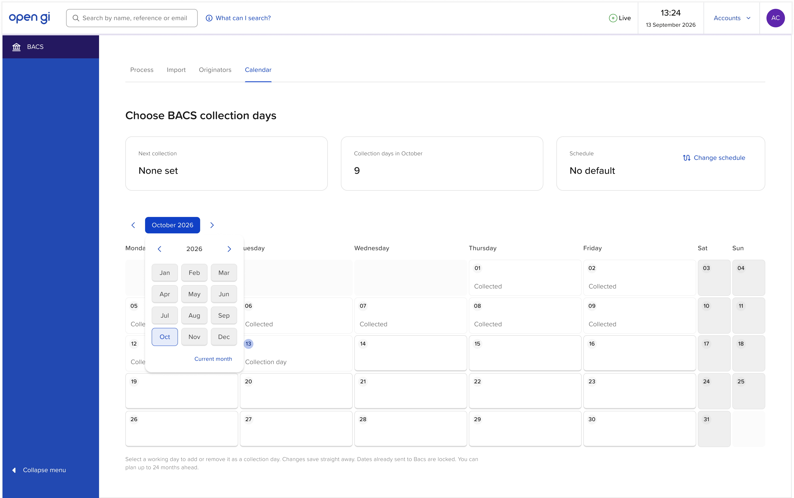
*CA-01-01: Month picker open from the month button.*

- Behaviour as section 7.

### CA-02 Add and remove single dates

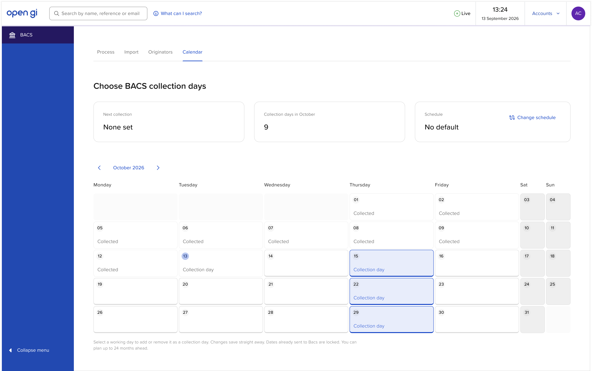
*CA-02-01: Several dates selected. Note: summary cards in this frame are not updated (section 12).*

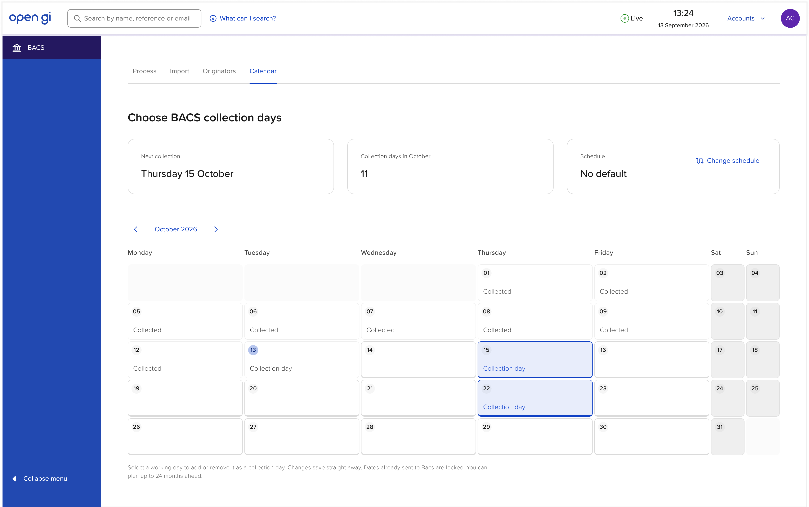
*CA-02-02: 15 and 22 October selected; Next collection and count updated.*

Steps:

1. User clicks a **Default** cell. It becomes **Selected** (*Collection day*). The change saves immediately.
2. User clicks a **Selected** cell. It returns to **Default**. The change saves immediately.
3. Summary cards update.

Rules:

- **No toast** for single-date changes. The cell itself is the feedback, and clicking again reverses it.
- Read-only, disabled and blank cells do nothing on click.
- A single-date change is an exception to the schedule. It **does not** change the Schedule card.
- **If a save fails** (Proposed): revert the cell and show a Buckholt **error** toast: title *Couldn't save*, body *{Weekday D Month} wasn't changed. Try again.* In the prototype, no failure path is needed unless simulated.

### CA-03 Change schedule: Every working day

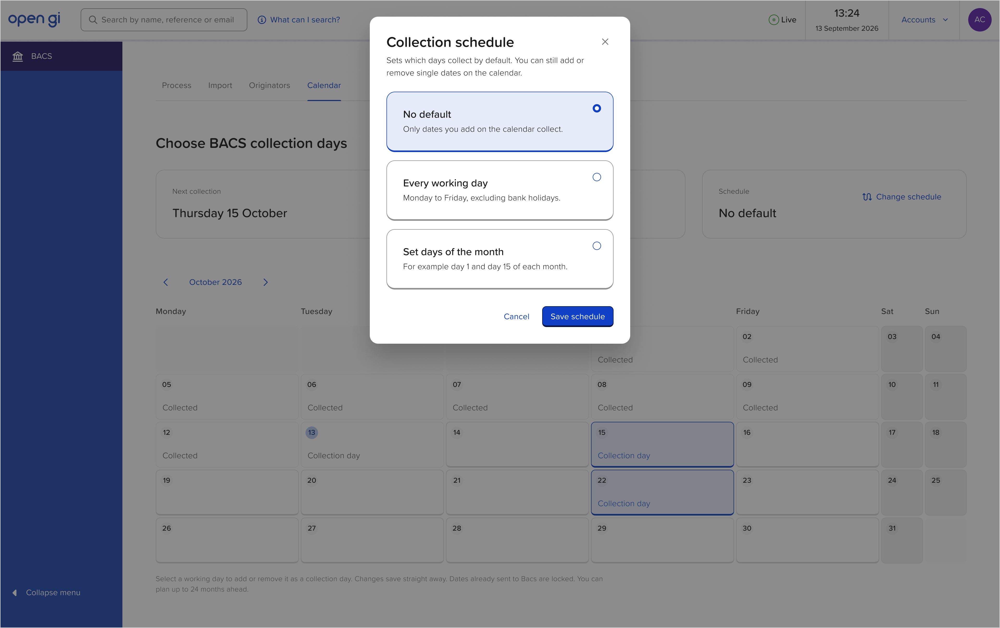
*CA-03-01: Collection schedule modal opened with the current schedule (No default) selected.*

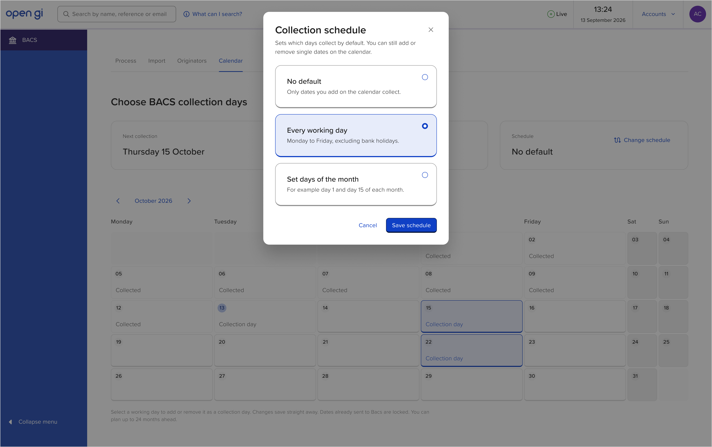
*CA-03-02: Every working day selected.*

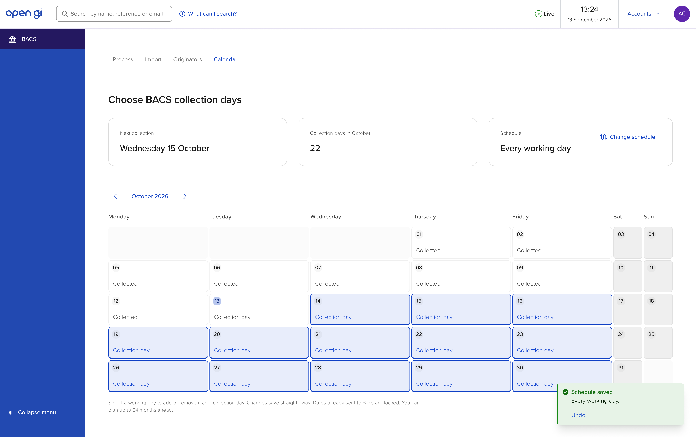
*CA-03-03: Saved. Every future working day is a collection day; toast confirms.*

Steps:

1. User selects **Change schedule**. The **Collection schedule** modal opens with the saved option pre-selected.
2. User selects **Every working day**.
3. User selects **Save schedule**. Modal closes, calendar and cards update, toast appears.

### CA-04 Change schedule: Set days of the month

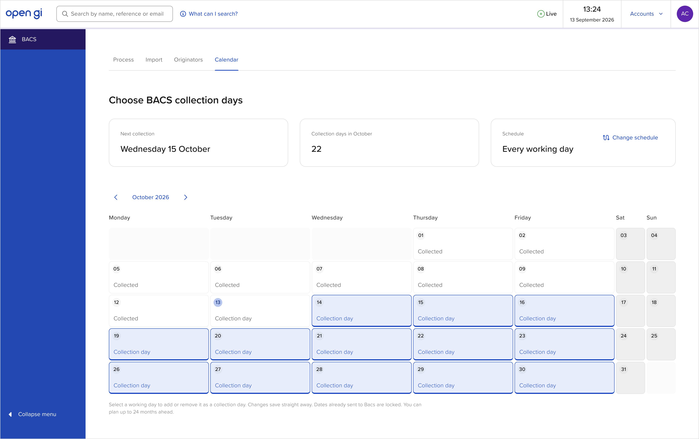
*CA-04-01: Starting state, schedule is Every working day.*

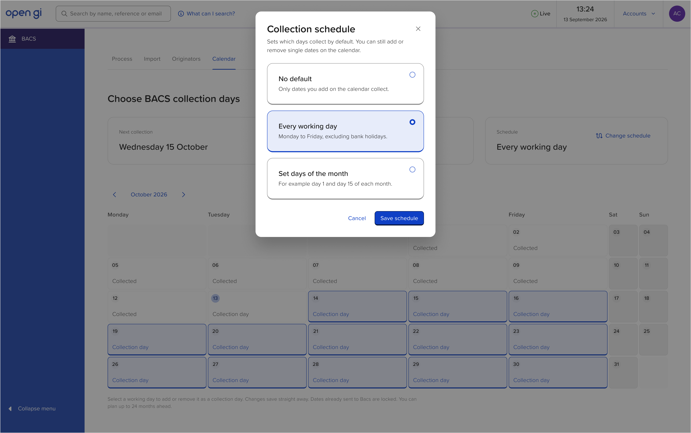
*CA-04-02: Modal opened with Every working day selected.*

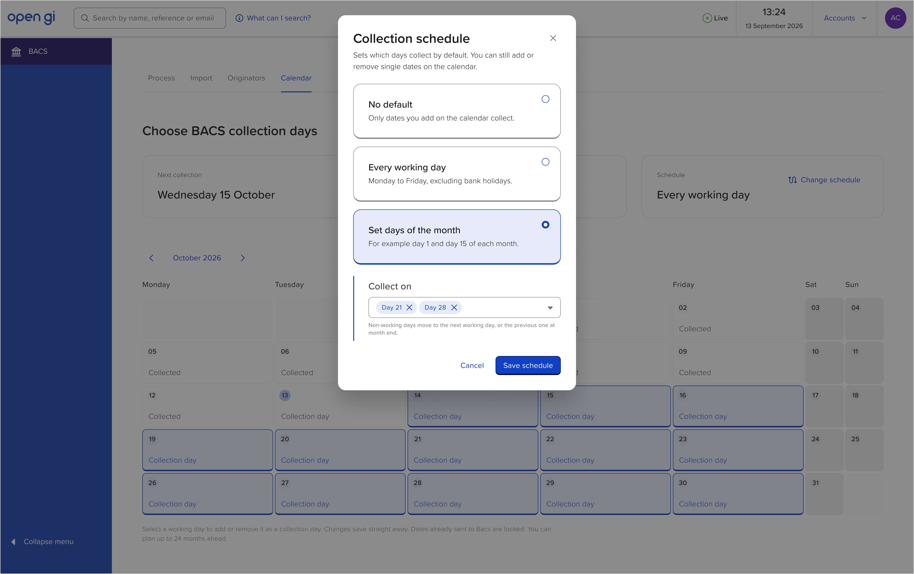
*CA-04-03: Set days of the month selected; Collect on multiselect revealed with Day 21 and Day 28.*

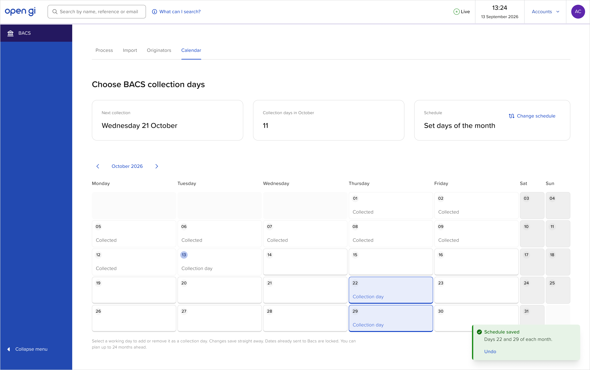
*CA-04-04: Saved. See section 12 for the correct dates and copy for this frame.*

- Selecting **Set days of the month** reveals the **Collect on** panel under the options, inside the modal (section 9.2).
- Saving with Day 21 and Day 28 makes **Wednesday 21** and **Wednesday 28 October** collection days, and no other future dates.

### CA-05 Change schedule: No default

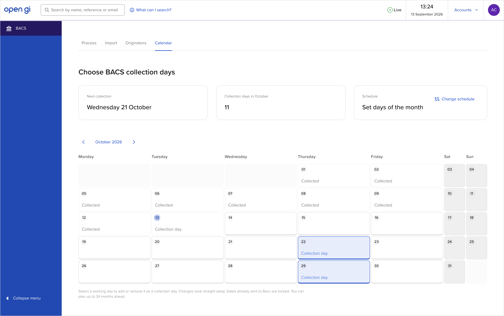
*CA-05-01: Starting state, schedule is Set days of the month.*

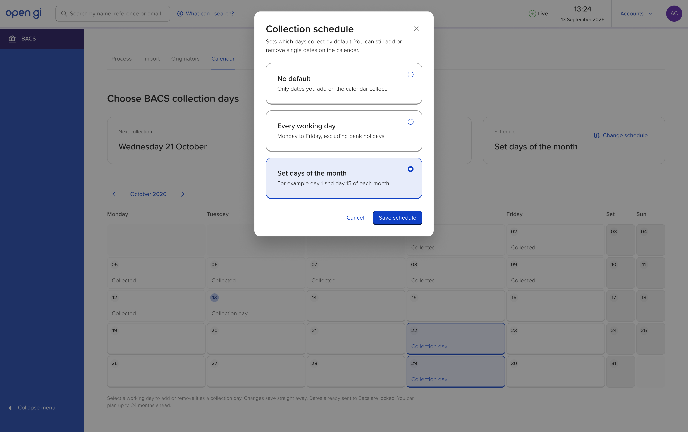
*CA-05-02: Modal opened with Set days of the month selected. The Collect on panel should also show here, pre-filled (section 12).*

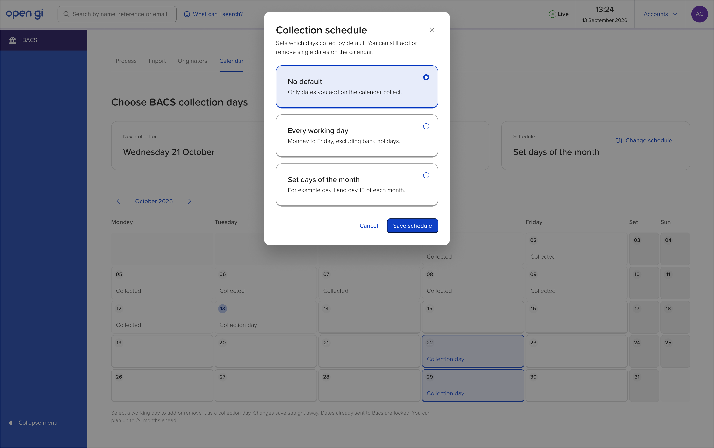
*CA-05-03: No default selected.*

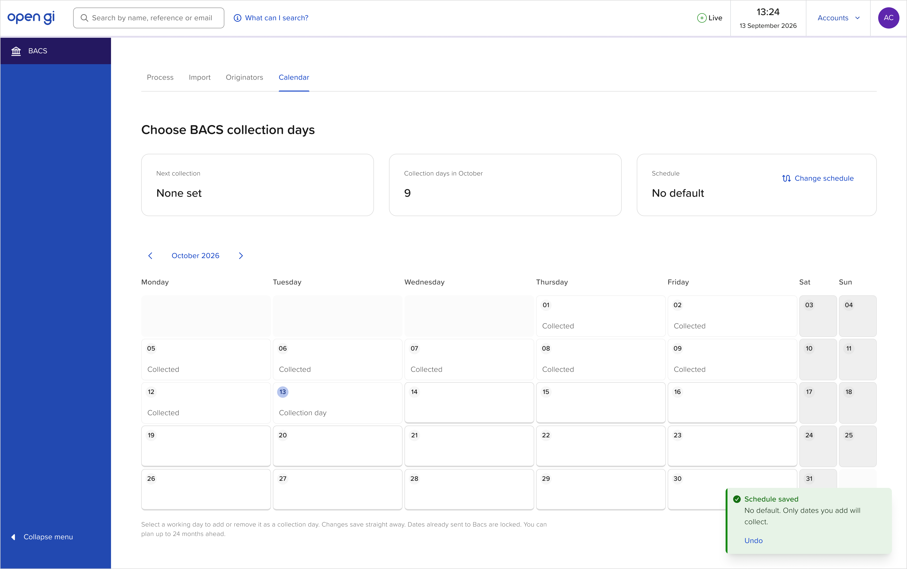
*CA-05-04: Saved. No future collection days; Next collection is None set.*

### CA-06 Bank holidays

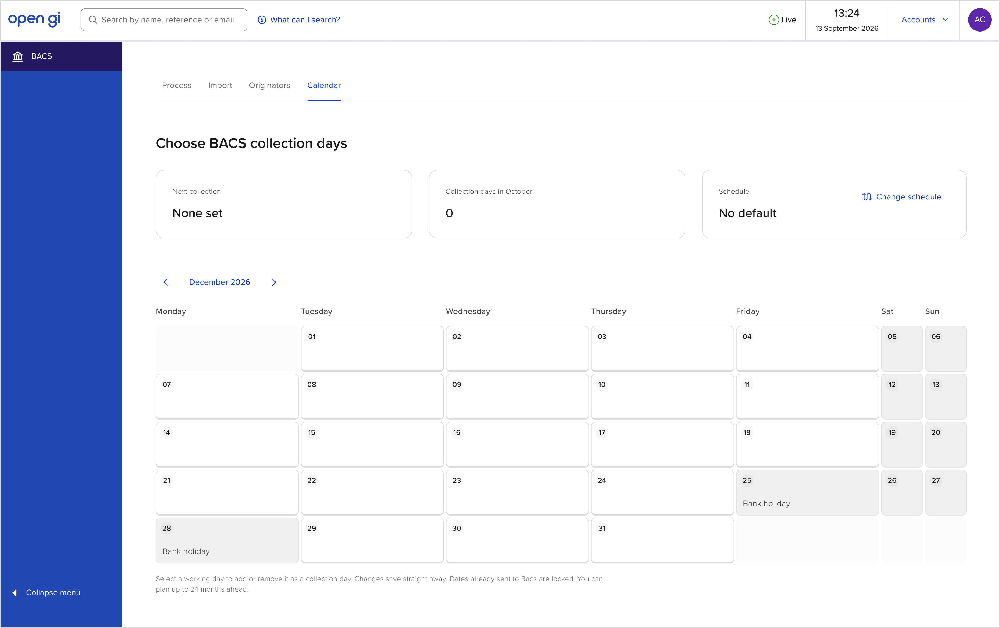
*CA-06-01: December 2026. Christmas Day (Fri 25) and Boxing Day substitute (Mon 28) are disabled with the label Bank holiday.*

- Bank holidays use the **Disabled** state with the label *Bank holiday*.
- A bank holiday on a weekend shows as a normal weekend cell (no label). Boxing Day 2026 is Saturday 26, so only the substitute Monday 28 is labelled.
- Christmas Eve and New Year's Eve are normal working days.

## 9. Collection schedule modal

### 9.1 Structure

*Reference: CA-03-01, CA-04-03.*

- **Title:** *Collection schedule*. Close × at top right.
- **Intro text:** *Sets which days collect by default. You can still add or remove single dates on the calendar.*
- **Three radio cards**, in this order:

| Option | Description |
|---|---|
| No default | Only dates you add on the calendar collect. |
| Every working day | Monday to Friday, excluding bank holidays. |
| Set days of the month | For example day 1 and day 15 of each month. |

- **Footer:** *Cancel* (text button) and *Save schedule* (primary), right aligned.
- On open, the **saved** option is selected. Choices are a draft until *Save schedule*.
- **Cancel**, the close ×, Escape, or clicking the backdrop discard the draft.
- Focus is trapped in the modal and returns to *Change schedule* on close.

### 9.2 Collect on (Set days of the month)

*Reference: CA-04-03.*

- Shown only when **Set days of the month** is selected, directly under the options, inset with a blue left rule.
- **Label:** *Collect on*.
- **Buckholt multiselect, tag variant.**
  - Options: *Day 1* to *Day 31*, as checkboxes.
  - **No "All" option** (that is the same as Every working day).
  - Selected days show as tags *Day N* with ×, sorted ascending.
  - Options list scrolls (about five rows visible) and floats over the content below.
  - Placeholder when empty: *Choose days*.
- **Helper text:** *Non-working days move to the next working day, or the previous one at month end.*
- **When the modal opens with Set days of the month already saved, this panel is shown and pre-filled with the saved days.**
- **Proposed:** if Set days of the month is selected with no days, *Save schedule* is disabled and the helper reads *Choose at least one day.*

### 9.3 Saving

- Saving **replaces every future editable date** with the new rule. Any single-date changes made before are cleared. Read-only dates are never touched.
- Saving with no change closes the modal with no toast.
- After a real change, show the **success toast** (section 10).

## 10. Toasts

Use the Buckholt **success** toast with an **Undo** action and **no close button**.

| Trigger | Title | Body |
|---|---|---|
| Save: Every working day | Schedule saved | Every working day. |
| Save: Set days of the month | Schedule saved | Days {list} of each month. e.g. *Days 21 and 28 of each month.* / *Day 15 of each month.* |
| Save: No default | Schedule saved | No default. Only dates you add will collect. |
| Undo selected | Change undone | (none) |
| Single-date save fails (Proposed) | Couldn't save | {Weekday D Month} wasn't changed. Try again. (error variant) |

Behaviour:

- Visible for **at least 8 seconds**. Timer **pauses on hover and keyboard focus**.
- **Undo** restores the previous schedule and all previous future dates exactly.
- A new toast replaces the current one. Undo only reverses the latest schedule save.
- Undo's accessible name: *Undo schedule change*.
- Toast container uses `role="status"`.

Day list format: one day `Day N`, two `Days A and B`, more `Days A, B and C`.

## 11. Rules and data

### 11.1 Today

- `TODAY` = **Tuesday 13 October 2026**, 13:24. Used by the calendar and the top bar.

### 11.2 Working days and bank holidays

A working day is Monday to Friday and not an England and Wales bank holiday.

| Date | Bank holiday |
|---|---|
| 31 Aug 2026 | Summer bank holiday |
| 25 Dec 2026 | Christmas Day |
| 28 Dec 2026 | Boxing Day (substitute) |
| 1 Jan 2027 | New Year's Day |
| 26 Mar 2027 | Good Friday |
| 29 Mar 2027 | Easter Monday |
| 3 May 2027 | Early May bank holiday |
| 31 May 2027 | Spring bank holiday |
| 30 Aug 2027 | Summer bank holiday |
| 27 Dec 2027 | Christmas Day (substitute) |
| 28 Dec 2027 | Boxing Day (substitute) |
| 3 Jan 2028 | New Year's Day (substitute) |
| 14 Apr 2028 | Good Friday |
| 17 Apr 2028 | Easter Monday |
| 1 May 2028 | Early May bank holiday |
| 29 May 2028 | Spring bank holiday |
| 28 Aug 2028 | Summer bank holiday |

Store these as data, not logic, so they can be replaced by a real feed later.

### 11.3 Collection day logic

For each date:

1. Weekend or bank holiday → **Disabled**.
2. Before today, or has a sent batch → **Read-only**.
3. Otherwise **editable**: it's a collection day if a single-date override says so, otherwise if the schedule rule says so.

Schedule rules:

- **No default:** no dates.
- **Every working day:** every working day.
- **Set days of the month:** for each chosen day N, take day N of the month (or the last day if the month is shorter). If that isn't a working day, use the **next working day in the same month**; if there is none, use the **previous working day**.

Overrides:

- Clicking an editable date stores an override only if it differs from the rule; clicking back to the rule's value removes the override.
- Saving a schedule clears all overrides on future editable dates (9.3).

### 11.4 Seed data and shared store

`data/calendar.js` (or the existing seed-data pattern) exports:

- `TODAY`
- `BANK_HOLIDAYS` (11.2)
- `schedule`: `{ type: 'none' | 'all' | 'days', days: [] }`, seeded as `{ type: 'none', days: [] }`
- `overrides`: map of ISO date → boolean, seeded empty
- `sentBatches`: every working day from **1 July 2026 to 13 October 2026** inclusive, each with a batch ID `A0000001` upwards in date order (not shown on the calendar; kept for Process)
- helper functions: `isWorkingDay(date)`, `isCollectionDay(date)`, `getCollectionDays(from, to)`, `getNextCollection()`

Process will later read `getCollectionDays()` for its collection date dropdown, so keep this logic out of the Calendar page code.

### 11.5 Expected results with the seed data (October 2026)

| State | Next collection | Collection days in October |
|---|---|---|
| No default, no overrides (CA-00-01, CA-05-04) | None set | 9 |
| No default + 15 and 22 Oct added (CA-02-02) | Thursday 15 October | 11 |
| Every working day (CA-03-03) | Wednesday 14 October | 22 |
| Days 21 and 28 (CA-04-04) | Wednesday 21 October | 11 |

December 2026, Every working day: 21 collection days.

## 12. Screenshot discrepancies (spec wins)

Build from the spec for these. They are Figma data errors, not intended behaviour.

| Frame | In Figma | Build this |
|---|---|---|
| All frames | Top bar date *13 September 2026* | *13 October 2026* |
| CA-02-01 | Cards show *None set* and *9* with 15, 22, 29 selected | *Thursday 15 October* and *12* |
| CA-03-03, CA-04-01, CA-04-02 | Next collection *Wednesday 15 October* | *Wednesday 14 October* (15 Oct is a Thursday, 14 is the first future collection day) |
| CA-04-04, CA-05-01, CA-05-02, CA-05-03 | 22 and 29 selected; toast *Days 22 and 29 of each month.*; next *Wednesday 21 October* | 21 and 28 selected; toast *Days 21 and 28 of each month.*; next *Wednesday 21 October* |
| CA-05-02 | Set days of the month selected but Collect on panel hidden | Panel shown, pre-filled with *Day 21* and *Day 28* |
| CA-06-01 | Card label *Collection days in October* while viewing December | *Collection days in December* |
| CA-01-01 | All months look enabled | Out-of-range months disabled (section 7) |

## 13. Accessibility

- Interactive cells are `<button>` elements with `aria-pressed` (true when Selected) and an accessible name such as *Wednesday 14 October 2026, collection day*. Add *, today* to today's name.
- Read-only and disabled cells are not focusable. Their date and label are readable as text.
- Visible focus ring on cells, chevrons, month buttons, link buttons and modal controls.
- Month heading updates are announced (`aria-live="polite"` on the month button text or a hidden status).
- Month picker: popover with Escape to close and focus return.
- Modal: Buckholt modal behaviour (focus trap, Escape, labelled by its title).
- Multiselect: Buckholt multiselect behaviour; each tag's × has the name *Remove day N*.
- State is never shown by colour alone: Selected cells carry the *Collection day* label.
- Touch targets at least 44 × 44px.

## 14. Changes from legacy

| Transactor | Mobius | Why |
|---|---|---|
| Months listed in a tree; dates in a table with checkboxes | Month calendar grid with clickable day cells | Faster to scan and edit |
| Check all / Uncheck all per month | Collection schedule (No default, Every working day, Set days of the month) | **New.** Set once instead of month by month |
| Weekends un-checkable | Weekends and bank holidays disabled, bank holidays labelled | Clearer why a day can't be used |
| No locking of past or sent dates shown | Past and sent dates read-only (*Collected* / *Collection day*) | Prevents changing dates already processed |
| Changes saved with OK | Each change saves immediately; schedule saves with a toast and Undo | Fewer steps, recoverable |
| Per-date Payment and AUDDIS passwords (Pay 1–3, DDI 1–3) | **Removed** | Believed obsolete under current Bacs submission; to confirm (15.2) |
| Configurable for 2 years | 24 months ahead | Matches legacy |

## 15. Open questions

1. **Bacs lead time.** With today as 13 October, a collection on 14 October would already have needed submitting on 12 October, yet 14 October is editable in Figma. Should dates inside the Bacs lead time be read-only? *Prototype: editable, as Figma.*
2. **Passwords.** Does any Mobius customer's bank still issue per-date Bacs passwords? If so, they need a home.
3. **History range.** How far back can users view? *Prototype: July 2026, the start of seed history.*
