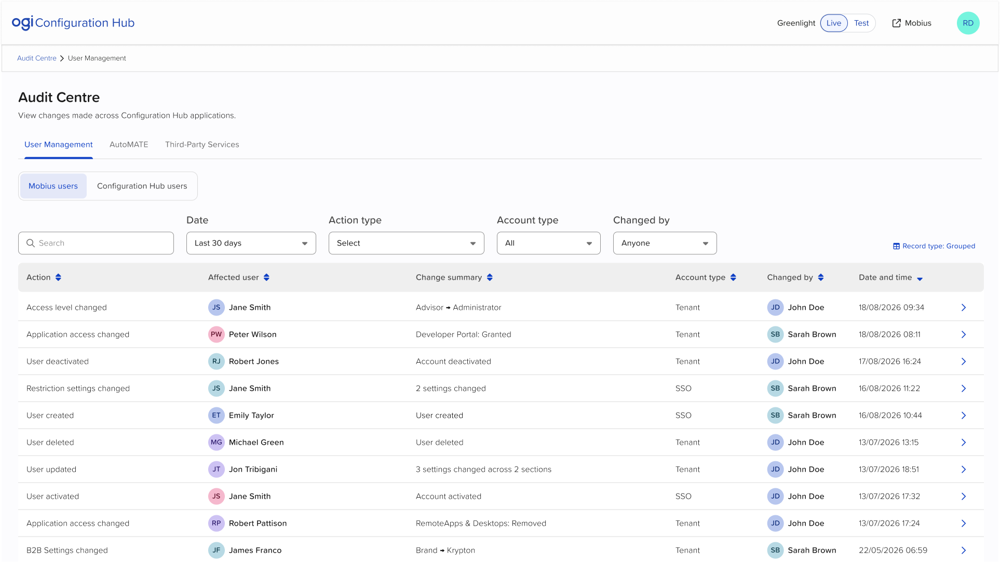
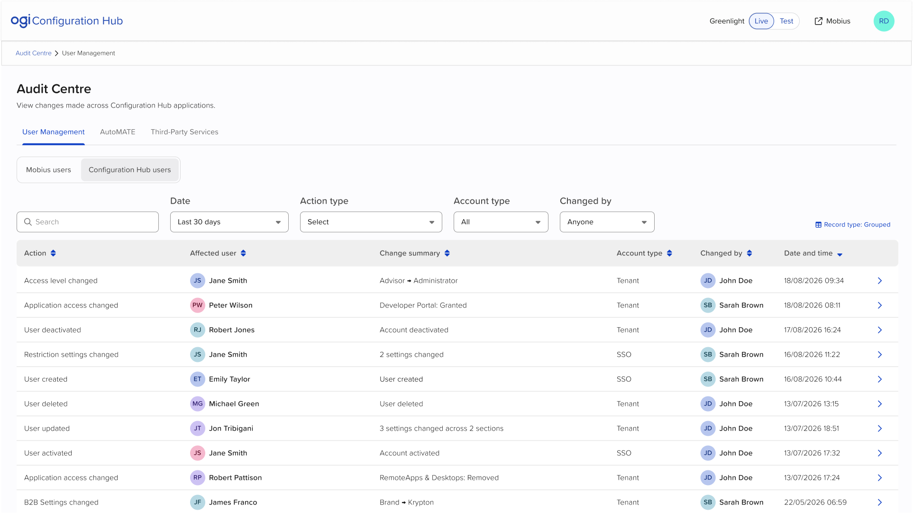
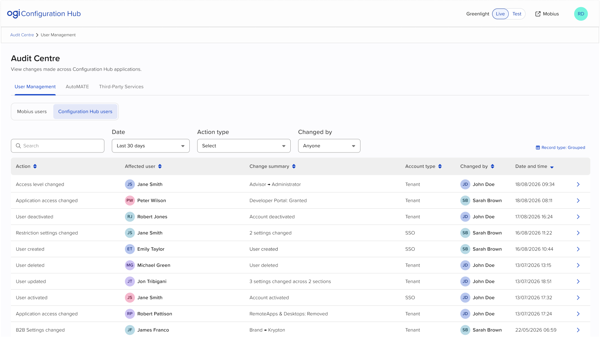

# Audit Centre: User Management (CH-AUDIT-UM): Feature Specification

## About this document
- **Product / location:** Configuration Hub > Audit Centre > User Management tab.
- **Readers:** developers, product, and Claude Code building a clickable prototype.
- **Prototype folder:** `prototypes/CH-AUDIT-UM/`
- **Screen IDs:** `AU-FF-SS`. AU is Audit Centre User Management, FF the flow (00 = base page), SS the step. Screenshots in `screenshots/` are named by screen ID.
- **Shell:** `CH-SHELL` spec, revision 7. Reuse the shared shell; do not copy it into this folder.
- **Viewpoint:** a client user with access to Audit Centre. No Open GI staff view.
- **Source tags:** **[Figma]** target design (frames in the Screen index), **[Decision]** agreed with Andrej or the team (dated); "spec" means decided in this spec and pending Andrej's review, **[Assumption]** to be validated by the developers' spike.
- **Revision:** 1, 5 Nov 2026. First version.

## What changed in this revision
| Area | Change |
|---|---|
| Revision 1 | First version. Covers the User Management tab with a content switcher between Mobius users and Configuration Hub users, the full Configuration Hub users view and its Audit details patterns, and the Mobius users table and filters without drawers. |

## Feature overview
- Audit Centre lets client administrators see what changed in Configuration Hub, who changed it and when. This prototype covers User Management, which now manages two separate kinds of account: Mobius users and Configuration Hub users. Each kind has its own Audit view, because the two lists, their actions and their columns differ. **[Decision]** Andrej, Nov 2026.
- **Users and permissions:** one role: a client user with access to Audit Centre. Open GI staff appear only as actors in records.
- **Dependencies:** CH-SHELL (header, environment, breadcrumb). The Configuration Hub users prototype (CH-USERS) defines the events audited here; this prototype does not link to it.
- **Out of scope for this prototype:**
  - The AutoMATE and Third-Party Services tabs. The tab bar shows only User Management, as in Figma.
  - Audit details drawers for Mobius users rows. Mobius rows show the chevron, but activating it does nothing. Record this as inert in `PROTOTYPE.md`.
  - Custom date range, export, retention settings and contextual History.
  - Sign-ins, failed sign-ins and self-service password or MFA-method changes. These are never audited. **[Decision]** Andrej, Nov 2026.

## Glossary
| Term | Meaning |
|---|---|
| Audit record | One row in the Audit table. In Grouped view, one record per saved action. |
| Mobius users | Accounts for Mobius, the Policy Administration System. Each has an account type: Tenant or SSO. |
| Configuration Hub users | Accounts for Configuration Hub. Separate from Mobius accounts. Created when an invitee accepts an email invitation. |
| Invitee | A person invited by email who has not yet created their account. Known only by email. |
| Pending | Invitation sent, link still valid (14 days). |
| Link expired | Invitation not used within 14 days. Stays in the users list until resent or deleted. |
| Role | Configuration Hub user role. Placeholder values while roles and permissions are in discovery: Administrator, Editor, Viewer. |
| Open GI user | Open GI staff acting in a client's Configuration Hub. Shown by name with the Open GI avatar. |
| System | The actor for events no person caused (an invitation link expiring). |
| Grouped / Individual | Record type. Grouped shows one record per saved action; Individual splits multi-change saves and bulk deletions into one row per change or account. |

## Data model

### Audit record
| Field | Format / validation | Shown where | Notes |
|---|---|---|---|
| Event ID | "evt_" followed by 8 lowercase letters and digits | Audit details, Event information | Unique per record |
| View | Mobius users or Configuration Hub users | Decides which view lists the record | Never both |
| Action | One value from the action list for its view | Table, drawer title, Action type filter | |
| Affected user | Name, email, username and avatar as they were at the event | Table, Event information | See identity rules |
| Change summary | Text, see the change summary table | Table | |
| Account type | Tenant, SSO, or Tenant and SSO | Mobius users table only | Not stored for Configuration Hub users |
| Changed by | Name and actor type: client user, Open GI user, or System | Table, Event information | |
| Date and time | DD/MM/YYYY HH:mm, 24-hour | Table, Event information | |
| Details | Structured content for the drawer pattern | Audit details | See AU-04 |
| Group | Links records split from one saved action | Individual view | |

### Identity rules **[Decision]** Andrej, Nov 2026
- Each record stores the affected user's name, email and username as they were at the event. Rows never look up the current user, so deleting or renaming a user never changes older rows.
- For actions that change a name, the row shows the name after the change.
- An invitee with no account yet is shown by email, with a generic person avatar (no initials).
- Email can't be edited in Configuration Hub, so it identifies one person across their whole history.
- Roles are shown by the name they had at the event, never by today's role name.

### Configuration Hub users: actions
| Action | Change summary | Changed by | Drawer pattern |
|---|---|---|---|
| "Invitation sent" | "Role: {role}" | Admin or Open GI user | Invitation details |
| "Invitation resent" | "Invitation resent" | Admin or Open GI user | Invitation details, plus Change details if resent from Link expired |
| "Invitation expired" | "Pending → Link expired" | System | Change details |
| "Invitation cancelled" | "Invitation cancelled" | Admin or Open GI user | Deleted invitation |
| "Invitation deleted" | "Invitation deleted" | Admin or Open GI user | Deleted invitation |
| "User created" | "Invitation accepted" | The invitee (self) | User details |
| "Name changed" | "{old full name} → {new full name}" | Admin or Open GI user | Change details |
| "Role changed" | "{old role} → {new role}" | Admin or Open GI user | Change details |
| "User activated" | "Account activated" | Admin or Open GI user | Change details |
| "User deactivated" | "Account deactivated" | Admin or Open GI user | Change details |
| "User updated" | "{n} settings changed" | Admin or Open GI user | Change details |
| "MFA reset" | "MFA reset" | Admin, Open GI user, or the user themselves | Change details |
| "User deleted" | "User deleted" (one account) or "{n} users deleted" | Admin or Open GI user | Deleted account details |

**Rules**
- "Invitation cancelled" is used when the link was still valid, and "Invitation deleted" when it had expired. Both match the confirmation copy in Configuration Hub users. **[Decision]** Andrej, Nov 2026.
- A save that changes more than one field is one "User updated" record. **[Decision]** Head of Product, 27 Aug 2026 (one saved action, one record).
- A bulk deletion is one "User deleted" record that lists every account, whatever its status. **[Decision]** 4 Sep 2026. A bulk deletion never mixes Mobius and Configuration Hub users. **[Decision]** Andrej, Nov 2026.

## Seed data

### Rules
- **Dates are relative to the prototype's current date**, written below as "today", "today −n". This keeps the default "Last 30 days" filter populated whenever the prototype is opened.
- **Organisation:** Greenlight (from CH-SHELL). Configuration Hub users have usernames that differ from their email.
- **Live environment:** the records below.
- **Test environment:** Configuration Hub users view has no records (exercises the empty state). Mobius users view shows the first five Mobius rows only.

### People
| Person | Email | Username | Notes |
|---|---|---|---|
| Sarah Brown | sarah.brown@greenlight.co.uk | sbrown | Client admin |
| John Doe | john.doe@greenlight.co.uk | jdoe | Client admin |
| Daniel Hughes | n/a | n/a | Open GI user |
| Emily Taylor | emily.taylor@greenlight.co.uk | etaylor | Named "Emily Tailor" until today −10 |
| Priya Shah | priya.shah@greenlight.co.uk | pshah | |
| Tom Walker | tom.walker@greenlight.co.uk | twalker | |
| Laura Chen | laura.chen@greenlight.co.uk | lchen | Named "Laura Chen-Ward" from today −3 |
| Alexandra Montgomery-Fitzgerald | alexandra.montgomery-fitzgerald@greenlight.co.uk | amontgomeryfitzgerald | Long name and email (truncation) |
| Marcus Reid | marcus.reid@greenlight.co.uk | mreid | Deleted today −6 |
| Hannah Okafor | hannah.okafor@greenlight.co.uk | hokafor | Deleted today −6 |
| Invitees | oliver.grant@, k.novak@, a.patel@, m.ross@, j.fraser@, r.lewis@greenlight.co.uk; christopher.hetherington-smythe@greenlight-insurance.co.uk | none | Email only |

### Configuration Hub users records (Live), newest first
| # | When | Action | Affected user | Change summary | Changed by | Details |
|---|---|---|---|---|---|---|
| 1 | today 09:12 | Invitation sent | oliver.grant@greenlight.co.uk | Role: Editor | Sarah Brown | Email, Role Editor, Link expires today +14 |
| 2 | today −1 16:40 | MFA reset | Tom Walker | MFA reset | John Doe | MFA: Set up → Reset |
| 3 | today −1 11:05 | MFA reset | Sarah Brown | MFA reset | Sarah Brown | Self-action |
| 4 | today −1 08:45 | User activated | Tom Walker | Account activated | Sarah Brown | Status: Inactive → Active |
| 5 | today −2 14:22 | Role changed | Priya Shah | Editor → Administrator | Daniel Hughes (Open GI) | Role: Editor → Administrator |
| 6 | today −3 10:30 | User updated | Laura Chen-Ward | 2 settings changed | Sarah Brown | Last name: Chen → Chen-Ward; Role: Viewer → Editor |
| 7 | today −4 09:00 | Invitation resent | k.novak@greenlight.co.uk | Invitation resent | John Doe | Role Viewer, Link expires today +10; Status: Link expired → Pending |
| 8 | today −5 02:00 | Invitation expired | k.novak@greenlight.co.uk | Pending → Link expired | System | Status: Pending → Link expired |
| 9 | today −6 15:45 | User deleted | 4 accounts (see AU-04 rules) | 4 users deleted | Sarah Brown | Marcus Reid (Active, Viewer); Hannah Okafor (Inactive, Editor); j.fraser@ (Link expired, Viewer); r.lewis@ (Pending, Viewer) |
| 10 | today −7 12:10 | Invitation cancelled | a.patel@greenlight.co.uk | Invitation cancelled | John Doe | Role Editor, Status Pending |
| 11 | today −8 08:55 | Invitation deleted | m.ross@greenlight.co.uk | Invitation deleted | Sarah Brown | Role Viewer, Status Link expired |
| 12 | today −9 17:20 | User deactivated | Tom Walker | Account deactivated | John Doe | Status: Active → Inactive |
| 13 | today −10 13:00 | Name changed | Emily Taylor | Emily Tailor → Emily Taylor | John Doe | Last name: Tailor → Taylor |
| 14 | today −11 10:02 | User created | Emily Tailor | Invitation accepted | Emily Tailor | Username etaylor, First name Emily, Last name Tailor, Email, Role Editor, Status Active, MFA Set up |
| 15 | today −12 09:30 | Invitation sent | emily.taylor@greenlight.co.uk | Role: Editor | Sarah Brown | |
| 16 | today −13 11:15 | Invitation sent | christopher.hetherington-smythe@greenlight-insurance.co.uk | Role: Viewer | John Doe | Link expires today +1 |
| 17 | today −15 15:30 | User created | Priya Shah | Invitation accepted | Priya Shah | Role Editor |
| 18 | today −16 10:00 | Invitation sent | priya.shah@greenlight.co.uk | Role: Editor | Daniel Hughes (Open GI) | |
| 19 | today −19 09:00 | Invitation sent | k.novak@greenlight.co.uk | Role: Viewer | John Doe | |
| 20 | today −20 14:05 | Role changed | Alexandra Montgomery-Fitzgerald | Viewer → Editor | Sarah Brown | |
| 21 | today −25 16:10 | User deactivated | Hannah Okafor | Account deactivated | Daniel Hughes (Open GI) | |
| 22 | today −27 11:45 | MFA reset | Laura Chen | MFA reset | Daniel Hughes (Open GI) | |
| 23 | today −40 10:20 | User created | Laura Chen | Invitation accepted | Laura Chen | Role Viewer |
| 24 | today −41 09:10 | Invitation sent | laura.chen@greenlight.co.uk | Role: Viewer | Sarah Brown | |
| 25 | today −60 13:35 | Role changed | Tom Walker | Editor → Viewer | John Doe | |
| 26 | today −95 09:00 | Invitation sent | tom.walker@greenlight.co.uk | Role: Editor | John Doe | |

Records 1 to 22 fall within the last 30 days (three pages at 10 per page). Records 23 to 26 appear only with a wider date preset.

### Mobius users records (Live)
Use the ten rows in the AU-00-01 screenshot, with dates rewritten as offsets in the same order (today, today, today −1, today −3, today −3, today −24, today −24, today −24, today −24, today −76). Add two more rows so pagination is exercised: "User updated", Robert Pattison, "2 settings changed", SSO, Sarah Brown, today −80; and "Access level changed", Peter Wilson, "Read Only → Advisor", Tenant, Daniel Hughes (Open GI), today −85.

## Prototype notes
- **Sources of truth:** Figma decides arrangement. Buckholt decides sizes, spacing, colours, icons and component styling. This spec decides behaviour, copy and data, and beats both. Same rule as CH-SHELL.
- **State:** held in memory. A reload resets to the seed data. The environment follows CH-SHELL.
- **Static areas:** Mobius users row chevrons (inert). Shell items as in CH-SHELL.
- **Viewport:** desktop first at 1440px, usable down to 1088. Narrower layouts are not designed.
- **CH-SHELL contract:**
  - Registry app: Audit Centre, switched on in the default seed variants.
  - Base page: Audit Centre > User Management.
  - Breadcrumb: "Audit Centre > User Management" on every screen.
  - Document title: "User Management | Audit Centre | Configuration Hub".
  - No unsaved-changes state.
  - No app-level header navigation.

## Buckholt mapping
| UI element | Buckholt component / pattern | Variant or state needed | Notes |
|---|---|---|---|
| Page structure | Page layout; Page body > Frame > Pane > Panel | | Inside CH-SHELL |
| Page title and description | Heading, Text block | Level 1 | |
| Application tabs | Tabs | One tab, selected | Switches content in place |
| User type switch | Gap 1 | | Content switcher |
| Search | Input group with Text input | Search icon | Common action: Search |
| Date | Select | | Native select |
| Action type, Changed by | Gap 3 | | Multi-select checklist dropdown |
| Account type | Select | | Mobius users view only |
| Record type | Menu button | Two options | |
| Audit table | Table | Sortable headers | Row actions, pagination and truncation are gaps |
| Avatars | Avatar | Initials | Open GI, System and generic variants are Gap 5 |
| Truncated text | Tooltip | | |
| Row chevron | Button | Icon-only, with Tooltip | |
| Audit details | Gap 2 | | Mobius blade precedent |
| Event information, details | Key-value pair | | |
| "Open GI" label in drawer | Tag | | |
| Change details table | Table | Not sortable | |
| Deleted account and invitation snapshots | Card | Non-interactive | |
| Close | Button | Primary | |

## Buckholt gaps
Build these under `prototypes/`, never in `components/`, after confirming each is still a gap in the live repo.
| # | Need | Why | Closest Buckholt option | Precedent | Expected behaviour |
|---|---|---|---|---|---|
| 1 | Content switcher (segmented toggle) | Switch between two views of one app | Response button | None | Single-choice group, two options, one always selected. Hover and focus states. Arrow keys move and select. |
| 2 | Drawer (side panel) | Audit details | None | `prototypes/shared/blade.*` | Opens from the right over a scrim, coloured header bar with title and close icon, scrolling body, footer with Close. |
| 3 | Filter bar and multi-select checklist dropdown | Action type and Changed by | Dropdown with Checkbox | None | See AU-02. |
| 4 | Table extras | Pagination, results per page, selected-row highlight, truncation | Table | None | See AU-00-01 behaviour. |
| 5 | Avatar variants | Open GI, System, email-only users | Avatar | Open GI avatar is a CH convention | Open GI: Open GI mark in a ring. System: system icon. Email-only: generic person icon. |
| 6 | Empty and no-results states | Table states | None | Originators spec | See States. |

## AU-00-01 · Mobius users view, populated
The default view when Audit Centre opens on User Management.

### Page header
- **Breadcrumb:** "Audit Centre > User Management".
- **Title:** "Audit Centre".
- **Description:** "View changes made across Configuration Hub applications."
- **Tabs:** "User Management" (selected).

### Content switcher
- Sits below the tabs and above the filter row, left-aligned. **[Figma]**
- Options: "Mobius users" (selected by default), "Configuration Hub users".
- Accessible group name: "User type".

### Filter row (left to right)
- **Search:** placeholder "Search".
- **Date:** label "Date". Options "Last 7 days", "Last 30 days" (default), "Last 90 days", "Last 12 months". **[Assumption]** preset list.
- **Action type:** label "Action type". Shows "Select" when nothing is chosen, which means all.
- **Account type:** label "Account type". Options "All" (default), "Tenant", "SSO", "Tenant and SSO".
- **Changed by:** label "Changed by". Shows "Anyone" when nothing is chosen.
- **Record type:** right-aligned on the filter row, label "Record type: Grouped" or "Record type: Individual".

### Table
- **Columns:** "Action", "Affected user", "Change summary", "Account type", "Changed by", "Date and time", and a chevron column.
- **Pagination row:** first, previous, page numbers, next, last; "Results per page" (10 default, 25, 50); "Showing {from}-{to} of {total}".

### Behaviour
- Default sort: Date and time, newest first. Every column except the chevron column is sortable, ascending then descending.
- Truncated cells show the full text in a Tooltip on hover and focus.
- Changed by for an Open GI user shows the Open GI avatar and the Tooltip "Open GI user" on the avatar.

## AU-00-02 · Hover on Configuration Hub users
The hover state of the unselected switcher option.

Hover changes only the option's appearance. Nothing changes until the option is selected.

## AU-00-03 · Configuration Hub users view, populated
The Configuration Hub users view with the Live seed.

### Differences from AU-00-01
- "Configuration Hub users" is selected.
- No Account type filter and no Account type column. Configuration Hub users have one account type, and the switcher already shows it. **[Decision]** spec.
- Action type options, in this order: "Invitation sent", "Invitation resent", "Invitation expired", "Invitation cancelled", "Invitation deleted", "User created", "Name changed", "Role changed", "User activated", "User deactivated", "User updated", "MFA reset", "User deleted".
- Changed by options: client users A to Z, then an "Open GI" group heading with Open GI users, then "System". **[Decision]** spec, pending Andrej's review.
- Table data comes from the Configuration Hub users seed, not the screenshot (see Known screenshot differences).

### Avatar and name display
| Case | Affected user | Changed by |
|---|---|---|
| Named user, current or deleted | Initials avatar + name as at the event | Initials avatar + name |
| Invitee with no account | Generic avatar + email | n/a |
| Open GI user | n/a | Open GI avatar + name, Tooltip "Open GI user" |
| System | n/a | System avatar + "System" |
| Self-action | Their avatar + name | Same as Affected user |
| Bulk deletion (Grouped view) | Generic avatar + "{n} users" | Initials avatar + name |

### States
| State | Trigger | What the user sees (exact copy) |
|---|---|---|
| Empty | No records in the selected date range and no other filters set (also Test, Configuration Hub users) | "No changes in this period." |
| No results | Filters or search return nothing | "No results found. Try changing your search or filters." |
| Error | Not reachable in the prototype | "Something went wrong. Try again." |

In the empty and no-results states the pagination row is hidden and the filters stay usable. Copy is **[Decision]** spec, pending Andrej's review.

## AU-01 · Switch between views
**Starts from:** AU-00-01.

### Steps
1. The user selects "Configuration Hub users".
2. The view changes to AU-00-03 in place: filters, table and pagination for Configuration Hub users. The page does not reload and the URL fragment changes so the view can be linked.
3. The user changes the date to "Last 90 days", sorts by Action and goes to page 2.
4. The user selects "Mobius users", then "Configuration Hub users" again.

### Rules
- Each view keeps its own search, filters, sort, page and record type for as long as the user stays on the page. Step 4 returns to page 2, sorted by Action, Last 90 days.
- Changing environment (CH-SHELL) returns to the base page with Mobius users selected and default filters.
- The result count is announced politely after a switch: "{n} results".

## AU-02 · Search and filter
**Starts from:** AU-00-03.

### Steps
1. The user types in Search. Results update after typing pauses. Search is not case sensitive.
2. The user opens Action type, ticks "Invitation sent" and "Invitation resent", and closes the list.
3. The user opens Changed by and ticks "System".

### Rules
- **Search matches:** Affected user name, email and username, Changed by name, and Change summary. Searching "k.novak" returns records 7, 8 and 19.
- **Multi-select display:** shows "Select" (Action type) or "Anyone" (Changed by) with nothing ticked. With one ticked, it shows that option. With more than one, it shows "{n} selected".
- **Filter interaction:** filters combine with AND. Options within one filter combine with OR.
- **Page reset:** any search or filter change returns to page 1.
- **Announcement:** the result count is announced politely after each change: "{n} results".

## AU-03 · Record type
**Starts from:** AU-00-03.

### Steps
1. The user opens "Record type: Grouped" and selects "Individual".

### Rules
- Individual view splits record 6 into "Name changed" (Laura Chen → Laura Chen-Ward) and "Role changed" (Viewer → Editor), both today −3 10:30.
- It splits record 9 into four "User deleted" rows, one per account, each with the summary "User deleted" and that account as Affected user.
- Every other record is unchanged.
- The label becomes "Record type: Individual". Sort, filters and search stay as they were; the page returns to 1.

## AU-04 · Open Audit details (Configuration Hub users)
**Starts from:** AU-00-03. No Figma frames yet: build from this spec, following the Mobius blade arrangement in the AU-00-01 file.

### Steps
1. The user activates a row's chevron, or clicks the row.
2. The drawer opens with the row highlighted as selected.
3. Close, the close icon, Escape or a click on the scrim closes it. Focus returns to the row's chevron.

### Drawer structure (all patterns)
- **Header bar:** "Audit details", with a close icon (accessible name "Close").
- **Title:** the Action, for example "Invitation sent".
- **Event information** (Key-value pair):
  - "User": name, or email for an invitee.
  - "Changed by": name, followed by the "Open GI" Tag for Open GI users.
  - "Date and time".
  - "Event ID".
- **No Account type** in Configuration Hub users drawers. **[Decision]** spec.
- **Footer:** "Close".

### Patterns
| Pattern | Section heading | Content (label: value) |
|---|---|---|
| Invitation sent | "Invitation details" | "Email", "Role", "Link expires" (DD/MM/YYYY) |
| Invitation resent | "Invitation details" | Same as above with the new expiry date. If the invitation had expired, a "Change details" section follows with the row Status: Link expired → Pending |
| Invitation expired | "Change details" | Status: Pending → Link expired |
| Invitation cancelled, Invitation deleted | "Deleted invitation" | Card: generic avatar, "Email", "Role", "Status" (Pending or Link expired) |
| User created | "User details" | "Username", "First name", "Last name", "Email", "Role", "Status", "MFA" ("Set up"). Same fields and order as the Configuration Hub user blade |
| Name changed, Role changed, User activated, User deactivated, User updated | "Change details" | Table with columns "Setting", "Previous value", "New value", one row per changed field |
| MFA reset | "Change details" | Row: MFA, Set up → Reset |
| User deleted | "Deleted account details" | One Card per account: avatar, name or email, "Username", "Email", "Role", "Status". Empty fields are omitted, not shown as "None" |

### Rules
- **Values as at the event:** all values are the stored ones from the event, never current values.
- **Bulk deletion cards** are listed in the order they were selected. The drawer body scrolls; the header and footer stay fixed.
- **Field labels** use sentence case. **[Decision]** Andrej, Oct 2026.

## Accessibility requirements
- **Content switcher:** single-choice group named "User type". Tab reaches the selected option; arrow keys move and select.
- **Sortable headers:** buttons with accessible names, for example "Sort by Action". The current sort is announced.
- **Row chevron:** accessible name "View details for {Action}, {Affected user}", with a Tooltip "View details".
- **Drawer:** a modal dialog named by its title. Focus moves to the title on open, Tab is contained within the drawer, Escape closes it, and focus returns to the trigger.
- **Avatars:** avatar types are never shown by appearance alone. The Open GI avatar has the Tooltip and accessible text "Open GI user"; the System avatar is paired with the word "System".
- **Live regions:** result counts are announced politely after search, filter, record type and view changes.

## Acceptance criteria
- Given the base page, then "Mobius users" is selected and the Account type column and filter are visible.
- Given AU-00-01, when the user selects "Configuration Hub users", then the Account type column and filter are not shown and the Live seed shows "Showing 1-10 of 22".
- Given AU-01 step 3, when the user switches views and back, then sort, filters and page are restored.
- Given the Configuration Hub users view, when the user searches "k.novak", then exactly records 7, 8 and 19 are shown.
- Given the Configuration Hub users view, when Changed by is "System", then only record 8 is shown and its Changed by shows the System avatar and "System".
- Given Record type Individual, then record 6 appears as two rows and record 9 as four rows.
- Given record 14, then Affected user and Changed by both show "Emily Tailor", and record 13 shows "Emily Tailor → Emily Taylor".
- Given record 1, then Affected user shows the email with a generic avatar.
- Given record 5, when its drawer opens, then Changed by shows "Daniel Hughes" followed by the "Open GI" Tag.
- Given record 9, when its drawer opens, then "Deleted account details" lists four cards, and the cards for j.fraser@ and r.lewis@ show no Username.
- Given record 7, when its drawer opens, then it shows "Invitation details" and a "Change details" row Status: Link expired → Pending.
- Given any drawer, when the user presses Escape, then it closes and focus returns to that row's chevron.
- Given the Test environment, when the user selects "Configuration Hub users", then "No changes in this period." is shown.
- Given a Mobius users row, when the user activates its chevron, then nothing happens.

## Open questions
| # | Question | Owner | Blocks build? |
|---|---|---|---|
| 1 | Date preset list: is it Last 7 days, Last 30 days, Last 90 days, Last 12 months? | Andrej | No. Build the assumed list |
| 2 | Changed by grouping under an "Open GI" heading | Andrej | No. Build as specified |
| 3 | Empty, no-results and error copy | Andrej | No. Build as specified |
| 4 | How the Mobius bulk-deletion row shows Affected user. This spec uses "{n} users" with a generic avatar | Andrej | No |
| 5 | "User details" section headings: should they mirror the Configuration Hub user blade's sections? | Andrej | No. Build as one section |
| 6 | Legal/Compliance position on showing named Open GI users to clients | PM | No |

## Known screenshot differences
| Screens | Screenshot shows | Build this instead |
|---|---|---|
| AU-00-03 | Mobius users data, Account type column and filter | Configuration Hub users seed; no Account type column or filter |
| AU-00-03 | Record type control may be missing | Record type right-aligned on the filter row, as in AU-00-01 |
| All | Drawer header "Audit Details" in Mobius frames | "Audit details" (sentence case) |
| AU-00-01 | "Showing 1-10 of 44,232" | Count from the seed data |
| AU-00-01 | Fixed dates in 2026 | Dates relative to today, as in Seed data |

## Screen index
Export each frame as PNG into `screenshots/` under its screen ID before building.
| Screen ID | Figma frame / file |
|---|---|
| AU-00-01 | "Audit - UM - Default view (Mobius)". https://www.figma.com/design/LCEXD3ORkD0iuyQAKv3NsX/%F0%9F%93%9AAudit?node-id=1262-423262 |
| AU-00-02 | "UM - Default view (Mobius) -> Hovering on Configuration Hub users". https://www.figma.com/design/LCEXD3ORkD0iuyQAKv3NsX/%F0%9F%93%9AAudit?node-id=1270-448850 |
| AU-00-03 | "UM - Configuration Hub users" (data is a placeholder). https://www.figma.com/design/LCEXD3ORkD0iuyQAKv3NsX/%F0%9F%93%9AAudit?node-id=1270-449978 |
| AU-01 to AU-03 | Use AU-00-01 and AU-00-03 |
| AU-04 | No frame. Built from this spec, arranged like the existing Mobius Audit details frames in the same file |

---

## Readiness checklist (all must pass before handoff)
- [x] Every screen in the index has a section, and every section has a screenshot or an explicit "no frame".
- [x] All copy is final, quoted, and checked against the Tone of Voice guide. *Items under Open questions 1 to 3 are pending Andrej's review.*
- [x] Every interactive element appears in the Buckholt mapping or in Buckholt gaps.
- [x] No HTML, class names, hex values or icon class strings anywhere in the spec.
- [x] Seed data covers empty, single, many and edge cases (long names, max values).
- [x] Every state has defined copy.
- [x] Open questions marked "Blocks build" are resolved or have an agreed assumption. *None block.*
- [x] Acceptance criteria cover every flow.
- [ ] Checked against the current `buckholt-reference.md` (and the live repo if the reference is more than about two weeks old). *Claude Code to confirm the six gaps against the live repo.*
