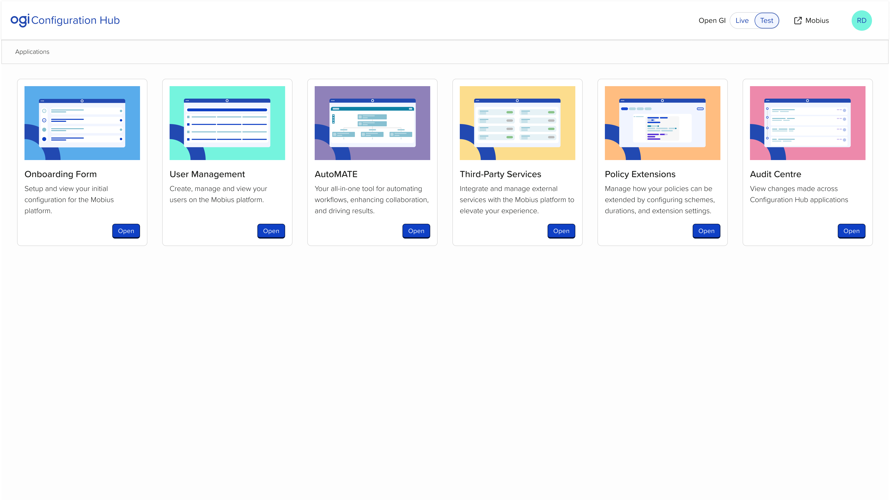
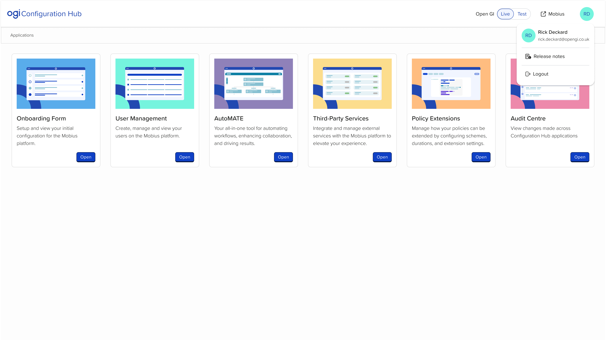
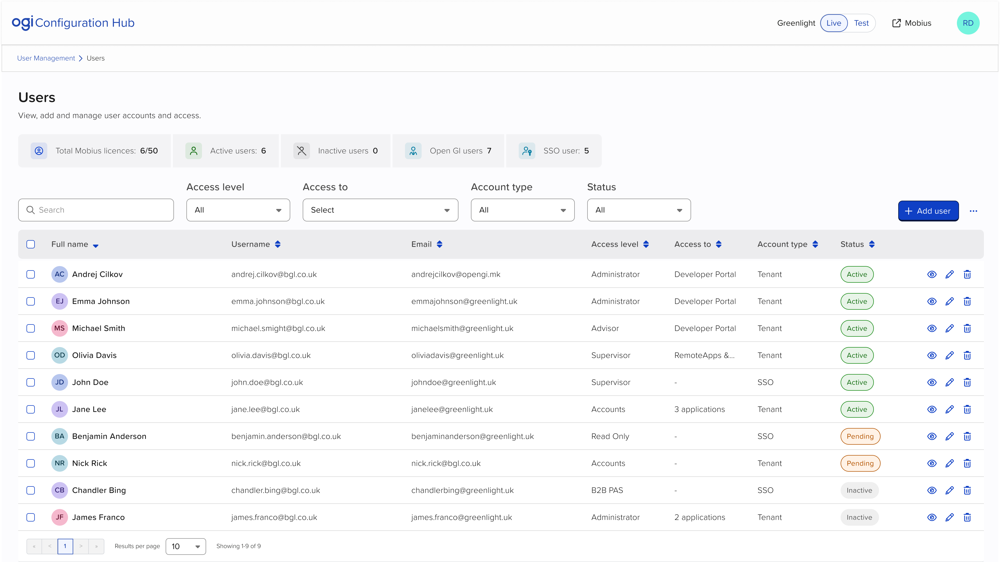

# Configuration Hub Shell (CH-SHELL): Feature Specification

## About this document
- **Product / location:** Configuration Hub > global frame (header, breadcrumb, app-card home).
- **Readers:** developers, product, and Claude Code building a clickable prototype.
- **Prototype folder:** `prototypes/CH-SHELL/`. The shell must be reusable by every CH feature prototype without being copied into each feature folder. How it is shared (for example a shared CH shell next to `prototypes/shared/app-shell`) is Claude Code's call.
- **Screen IDs:** `SH-FF-SS`. SH is the shell, FF the flow (00 = base page), SS the step. Screenshots in `screenshots/` are named by screen ID.
- **Shell:** this document is the shell. CH feature specs reference it as "Shell: `CH-SHELL` spec" and describe only their own content, breadcrumb trail and the items listed under "Contract for feature specs".
- **Viewpoint:** a client user only. No Open GI staff view, no tenant dropdown, no OGI-only apps, fields or behaviour. The prototype should look as close as possible to what a client sees.
- **Source tags:** **[Figma]** target design (Navigation file and User Management file, frames in the Screen index), **[Observed]** UAT build of 15 Oct 2026, **[Context]** Andrej's briefing recorded in the CH product context (baseline 17 Oct 2026), **[Decision]** agreed with Andrej (dated) or, where marked "spec", decided in this spec at Andrej's request and pending his review, **[Assumption]** to be validated.
- **Revision:** 3, 19 Oct 2026. App name, button hierarchy and tenant dropdown questions resolved. Ready for handoff once the screenshots are exported (see Readiness checklist).

## What changed in this revision
| Area | Change |
|---|---|
| Revision 3 | App 5 renamed "Policy Extensions" (Figma fixed by Andrej). Primary Open button confirmed with the design system designer. Tenant dropdown confirmed as Open GI-only on the integration server; never shown to tenants on UAT or Live. |
| Header | Layout, environment control and avatar menu checked against Figma. The client environment control is the two-option Live / Test control from the home frame; the "Open GI - ZZ09" dropdown frame is the Open GI staff tenant selector and is not built (see Known screenshot differences). |
| Test alert | Approved by Andrej, 19 Oct 2026. Figma has no Test indicator; the alert in this spec is the design. |
| Avatar menu | Identity header includes the avatar, as in Figma. Action label now follows Buckholt's Logout common action ("Logout"), per Andrej. |
| App registry | Order taken from Figma. Illustration assets mapped. |
| Open button | Primary, as in Figma (was assumed Secondary). |
| Breadcrumb | Sits in its own full-width band between the header and the page content, as in Figma. In-app trail confirmed by the User Management frame ("User Management > Users"). |
| Home heading | Figma has no visible title, so the level 1 heading is visually hidden. |

## Feature overview
- Configuration Hub lets a client organisation configure and manage parts of Mobius, Open GI's Policy Administration System. The shell is the frame around every CH app: it tells users which organisation and which environment (Live or Test) they are working in, lets them open the apps available to them, and shows them where they are. **[Context]**
- The highest-risk moment the shell must prevent is a user changing Live configuration while believing they are in Test (or the reverse). Environment visibility is treated as a safety requirement, not decoration. **[Decision]** Andrej, 19 Oct 2026.
- **Users and permissions:** one role is shown: a client user with access to Configuration Hub. Role-based differences inside CH (roles and permissions discovery) are not modelled. **[Assumption]**
- **Dependencies:** every CH feature prototype. In production, per-tenant feature flags (`<flag>-<tenantcode>`) decide which app cards exist; the prototype replaces them with a seeded app list. **[Observed]**
- **Out of scope for this prototype:**
  - Release Notes: the new-release pop-up, the Release Notes pages, and the "Release notes" item in the avatar menu. The item and its divider are omitted, not shown as a dead link.
  - The "app failed to load" error modal and any loading feedback on Open (specced separately).
  - Onboarding Form-only access (pre-tenant state).
  - Authentication, sign-in and session expiry (Azure AD B2C).
  - Open GI staff view, including the tenant dropdown.
  - App-level header navigation content (for example AutoMATE's "Workflows" link). The shell reserves the place for it; see "Contract for feature specs".

## Glossary
| Term | Meaning |
|---|---|
| Shell | The global CH frame: header, Test alert, breadcrumb band and app-card home. |
| Organisation | The client company using CH. Shown by name in the header. |
| Environment | Live or Test. Each client has one tenant per environment. **[Context]** |
| Live environment | The tenant the client trades on. |
| Test environment | A separate tenant for trying changes. During onboarding only Test exists; Live is copied from Test later. **[Context]** |
| Tenant | A client's isolated Mobius environment, identified by a code (site code), for example ZZ09. Not shown to client users. |
| App | A CH application opened from a card on the home page, for example User Management. |
| App card | A card on the home page representing one app. |
| Base page | The first page an app opens on, for example Users in User Management. |

## Data model
| Field | Format / validation | Shown where | Notes |
|---|---|---|---|
| Organisation name | Text, 1 to 120 characters | Header | Assumed to be the Onboarding Form "Company Name". **[Assumption]** |
| Environments | Set of Live and/or Test, each with a tenant code (two letters plus two digits) | Header (environment control or tag) | Tenant codes are data only. Never shown to client users. |
| Current environment | Live or Test | Header, Test alert, document title | Exactly one at a time. |
| User first name, last name | Text | Avatar menu | Shown as "First Last". |
| User initials | First letter of first name plus first letter of last name, upper case | Avatar button, avatar in menu | Fallback when a name part is missing: first two letters of the email local part. **[Assumption]** |
| User email | Email | Avatar menu | Read-only. |
| App id | Fixed key | Not shown | Maps cards to prototype pages and assets. |
| App name | Proper noun from the App registry | Card title, breadcrumb root, document title | Product names keep their own casing. |
| App description | One sentence, see copy rules | Card | Final copy in the App registry. |
| App illustration | SVG asset supplied by Andrej | Card | Decorative. Mapping in the App registry. |
| App visibility | Per environment: shown or hidden | Home | Seeded, not editable in the prototype. |
| App destination | Feature prototype base page, or the shell's app placeholder page | Open button target | |

**Rules**
- Exactly one environment is current at any time.
- If the organisation has both environments, the user can switch. If it has only one, the environment is shown but cannot be switched.
- On first load the current environment is Live if it exists, otherwise Test. **[Decision]** spec.
- Only apps that are active and client-visible can appear as cards. AutoMATE (feature-flagged), Audit Centre (in development) and Webhooks (proof of concept) are not client-visible today. **[Context]**
- Every visible app has exactly one card. Card order follows the registry; hidden apps leave no gap.
- The app set is the same in Live and Test by default. Seed data may differ per environment so feature specs can model a staged rollout. **[Assumption]**, see Open questions 2.

### App registry (all apps the shell knows about)
| Order | App | Client-visible today | In default seed | Description (final copy) | Illustration asset |
|---|---|---|---|---|---|
| 1 | Onboarding Form | Yes (view-only once the tenant exists) | Yes | "View the business details you shared with us when you joined." | `Onboarding Form Image - Card.svg` |
| 2 | User Management | Yes | Yes | "Add and manage your Mobius users and what they can access." | `User Management Image - Card.svg` |
| 3 | AutoMATE | No (feature-flagged) | No | "Build workflows that take care of routine Mobius tasks for you." | `AutoMATE Image- Card.svg` |
| 4 | Third-Party Services | Yes | Yes | "Connect Mobius to services like email, SMS and payments." | `3rd Party Services Image - Card.svg` |
| 5 | Policy Extensions | Yes, but likely to be hidden | No | "Set how policies can be extended for each scheme." | `Policy Extension Configuration - Card.svg` |
| 6 | Audit Centre | No (ships about late Nov to early Dec 2026) | No | "See what changed in Configuration Hub, when and by whom." | `Audit Centre - Card.svg` |

- Order and names are **[Figma]**. "Policy Extensions" confirmed by Andrej, 19 Oct 2026; the asset file name still says "Policy Extension Configuration", which does not affect the UI.
- Policy Extensions is off in the default seed because its clients are off-boarding and the app is expected to be hidden. **[Context]**
- Webhooks is not in the registry. When the Webhooks app is specced, its feature spec adds it.
- A feature spec switches its own app on (for example the Audit Centre spec turns on Audit Centre). See "Contract for feature specs".
- Assets: supplied by Andrej in `Navigation - Logo and navigation items.zip` (19 Oct 2026), together with the lockup `Navigation - Logo and navigation items.svg`. Use them as supplied.

### Card description copy rules **[Decision]** spec
Checked against the Brand Language and Tone of Voice guide (Human, Clear; "be concise", "write for kids", British English, sentence case, exclamation marks used sparingly).
- One sentence, 65 characters or fewer, ending with a full stop. No exclamation marks or questions.
- Starts with a verb that says what the user can do, addresses the user as "you/your", and names the benefit, not the technology.
- British English. App names, "Mobius" and "Configuration Hub" keep their product casing; everything else is sentence case.
- No jokes, hype or idioms. The guide's playful register suits marketing; a card description has to explain the app to someone who has never opened it, so clarity wins. This replaces copy such as "Your all-in-one tool for automating workflows, enhancing collaboration, and driving results" (vague, hype) and "Your friendly neighborhood Webhooks" (joke, US spelling). **[Figma]**, **[Observed]**
- "We/us" means Open GI.

## Seed data
Fictional organisations and people. Default seed is **Northgate**. The other variants exist to exercise edge cases and are selected without visible UI (for example a URL parameter; Claude Code's choice).

| Variant | Organisation name | Environments (tenant codes) | User | Email | Visible apps (registry order) |
|---|---|---|---|---|---|
| Northgate (default) | "Northgate Insurance Services" | Live NG01, Test NG02 | Sophie Marchetti | sophie.marchetti@northgate-insurance.co.uk | Onboarding Form, User Management, Third-Party Services |
| Long names | "Abbotsford Kingsley Commercial and Speciality Insurance Brokers" | Live AK01, Test AK02 | Alexandra Montgomery-Fairweather | alexandra.montgomery-fairweather@abbotsfordkingsley-insurancebrokers.co.uk | Onboarding Form, User Management, Third-Party Services |
| All apps | "Northgate Insurance Services" | Live NG01, Test NG02 | Sophie Marchetti | as default | All six registry apps |
| Test only (newly onboarded) | "Harbourside Underwriting" | Test HU01 only | Daniel Okafor | daniel.okafor@harbourside-underwriting.co.uk | Onboarding Form, User Management, Third-Party Services |
| Staged rollout | "Northgate Insurance Services" | Live NG01, Test NG02 | Sophie Marchetti | as default | Live: default set. Test: default set plus AutoMATE |

Notes
- Tenant codes follow the observed format (ZZ09, BR01, AZ01). Whether Live and Test have different codes is an **[Assumption]**.
- There is no empty-home variant: after the tenant exists the Onboarding Form card is always visible, and the pre-tenant state is out of scope.

## Prototype notes
- **Sources of truth:** Figma screenshots for layout, this spec for behaviour and copy, Buckholt for component behaviour and styling.
- **State:** held in memory, except the current environment, which persists across page navigation within the same browser tab so it carries into feature prototypes. A new tab starts from the seed rule (Live if it exists). This deliberately differs from the template default "a reload resets to the seed data". **[Decision]** spec.
- **Static (inert) areas:**
  - Mobius link: real link appearance and accessible name; activating it does nothing in the prototype.
  - Logout: real menu item; activating it closes the menu and does nothing else.
  - Both are recorded in `PROTOTYPE.md` as inert.
- **Interactive:** lockup link, environment control, avatar menu (open, close, keyboard), breadcrumb links, Open buttons, skip link.
- **App placeholder page:** when an app has no feature prototype yet, Open goes to a placeholder page (SH-03-01) so breadcrumb and environment behaviour can be tested.
- **Viewport:** desktop first at 1440px. Must stay usable down to the 1088 reference breakpoint: the organisation name truncates first; no header item wraps onto a second line. Narrower layouts are not designed. **[Assumption]**

## Buckholt mapping
| UI element | Buckholt component / pattern | Variant or state needed | Notes |
|---|---|---|---|
| Page structure | Page layout with Header and Main regions only (no Sidebar, no Footer); Main: Page body > Frame > Pane > Panel | | Header content itself is a gap (application chrome). |
| Lockup (Open GI logo and "Configuration Hub") | None | | Gap 1. Supplied as one SVG with outlined text, so it needs an accessible name from its link. |
| Organisation name | Plain text in header | Truncation with Tooltip | Tooltip exists; header placement is part of Gap 1. |
| Environment control (two environments) | Response button (radio, single-select) | Two options, compact, header placement | Gap 2. Figma shows a segmented pill with the selected option outlined. |
| Environment tag (one environment) | Tag | Neutral, informational | Not interactive. No Figma frame. |
| Test alert | Alert | Informational, not dismissible | Placement under the header across all pages is Gap 3. |
| Mobius link | Link | External link common action (icon before label, as in Figma) | Opens in a new tab in production. |
| Avatar button | Avatar inside Menu button | Initials, circular | Accessible name and Tooltip required (icon-only control). |
| Avatar menu | Menu button / Menu | Identity header (avatar, name, email; non-interactive), divider, one item | Non-interactive identity header is Gap 4. |
| Logout | Menu item using the Logout common action | Buckholt label and icon | Label as fixed by Buckholt. |
| Breadcrumb band | Breadcrumb | Single item (current, plain text); multi-item (links plus current) | Full-width band between header and content per Figma; truncation is Gap 5. |
| Home heading | Heading | Level 1, visually hidden | |
| App card | Card | Illustration, title, description, action | Only the Open button is interactive, so no clickable-card state is needed. Illustrations are Gap 6. |
| Card grid | Bootstrap grid inside Panel | Equal-height cards per row, left-aligned, wrapping | Figma shows six cards in one row at desktop width. |
| Open button | Button | Primary, right-aligned at the bottom of the card **[Figma]**; confirmed with the design system designer | Accessible name includes the app name. |
| Unsaved changes confirmation | Modal | Two actions | Used only through the feature contract. |
| Skip link | None | | Gap 7. |
| App-level header navigation slot | None | | Gap 8. Reserved, not built here. |

## Buckholt gaps
Not in `buckholt-reference.md` (commit `211e365`, 19 Oct 2026). Claude Code: confirm against the live repo and remove any item the repo now documents. Build the rest under `prototypes/`, never `components/`, and log them in `SPEC-CHANGES.md` section C.

| # | Need | Why | Closest Buckholt option | Precedent (if any) | Expected behaviour |
|---|---|---|---|---|---|
| 1 | Application chrome: CH top bar with lockup, organisation area, external link and avatar | Every CH page needs it; Buckholt has a Header region but no top-bar component | Page layout Header region | `prototypes/shared/app-shell` (Mobius PAS chrome; structural precedent only, not CH's design) | Single row. Left: lockup as one link to home. Right, in order: organisation name with environment control, Mobius link, avatar. Reserved space after the lockup for app-level navigation (Gap 8). Sticky at the top on scroll **[Assumption]** |
| 2 | Two-option environment switch (Live / Test) | The client control is a segmented either/or choice in the header. Switch is wrong (on/off, not two named states); Tabs and Page navigation change content or pages, not context; Dropdown would hide the current choice behind a click | Response button (radio, single-select) | Audit Centre Grouped / Individual (same gap) | Radio-group semantics; selection takes effect immediately; selected option shown by the outlined pill and not by colour alone |
| 3 | Global environment alert | Persistent safety indicator for Test on every page, including inside apps | Alert | None | Full width, directly under the header and above the breadcrumb band, on every page while Test is current; not dismissible; not announced on page load |
| 4 | Menu with a non-interactive identity header | Avatar menu shows avatar, name and email above the actions | Menu button / Menu | None | Identity header is plain content, not focusable, not a menu item; separated from the actions by a divider; arrow keys move only between items |
| 5 | Breadcrumb truncation | Long app, section or item names | Breadcrumb plus Tooltip | None | A crumb longer than about 32 characters truncates with an ellipsis; full text in a Tooltip on hover and focus; accessible name is always the full text. Threshold is an **[Assumption]** |
| 6 | App card illustrations | Each card has an illustration; Buckholt has no illustration set | Card media area | Supplied SVG assets | Shown full card width at the top of the card, as in Figma; decorative (no alternative text) |
| 7 | Skip link | Keyboard users need to bypass the header on every page | None | None | First focusable element; hidden until focused; text "Skip to main content"; moves focus to Main |
| 8 | App-level header navigation slot | AutoMATE already shows "Workflows" next to the CH lockup; other multi-journey apps will follow | Page navigation | AutoMATE (production) | Not built in this prototype. Reserved space only; the AutoMATE spec defines content and behaviour |

## SH-00-01 · Home, Live, populated
The page every client user lands on after sign-in: shows the organisation, the environment and the apps they can open.

### Header (left to right) **[Figma]**
1. **Lockup:** the supplied lockup asset (Open GI logo and "Configuration Hub"). The whole lockup is one link to the home page. Accessible name: "Configuration Hub home". **[Decision]** spec.
2. **App-level navigation slot:** empty on the home page.
3. **Organisation and environment:** "Northgate Insurance Services" as plain text, followed by the environment control with options "Live" and "Test" ("Live" selected). Accessible group name: "Environment".
4. **Mobius link:** External link icon followed by "Mobius". Accessible name: "Mobius (opens in a new tab)". Inert in the prototype.
5. **Avatar:** initials "SM". Accessible name: "Account menu for Sophie Marchetti". Tooltip: "Account menu".

### Breadcrumb band **[Figma]**
- Full-width band under the header, separated from header and content.
- Content: "Applications" (single crumb, current page, plain text, not a link). **[Observed]**, **[Figma]**

### Page header
- **Heading (level 1):** "Applications", visually hidden (Figma has no visible title).
- No description, no actions.

### App cards
One card per visible app, in registry order. The default seed shows three cards.

| Card | Title | Description | Button | Button accessible name |
|---|---|---|---|---|
| 1 | "Onboarding Form" | "View the business details you shared with us when you joined." | "Open" | "Open Onboarding Form" |
| 2 | "User Management" | "Add and manage your Mobius users and what they can access." | "Open" | "Open User Management" |
| 3 | "Third-Party Services" | "Connect Mobius to services like email, SMS and payments." | "Open" | "Open Third-Party Services" |

With the "All apps" seed, AutoMATE, Policy Extensions and Audit Centre take their registry positions with the copy in the App registry and accessible names "Open AutoMATE", "Open Policy Extensions", "Open Audit Centre".

Each card, top to bottom **[Figma]**: illustration (decorative), title (heading level 2), description, Open button (Primary, right-aligned at the bottom). Only the button is interactive.

### Behaviour
- **Open:** goes to the app's feature prototype base page if one exists, otherwise to SH-03-01 for that app. The current environment carries over.
- **Hover and focus:** Buckholt defaults for Button and Link. Cards have no hover state of their own.
- **Card layout:** cards share a fixed width and, within a row, the same height; Open buttons align along the bottom of the row. Cards are left-aligned; with fewer cards than fit in a row, the remaining space stays empty. Descriptions wrap and never truncate.
- **Organisation name:** truncates with an ellipsis when space runs out; full name in a Tooltip on hover and focus; full name is always available to assistive technology.
- **Header:** visible on every page; sticky on scroll. **[Assumption]**
- **Document title:** "Applications | Configuration Hub".
- **Keyboard:** see Accessibility requirements.

### States
| State | Trigger | What the user sees (exact copy) |
|---|---|---|
| Populated (Live) | Default seed | As above. |
| Populated (Test) | Test selected | SH-00-02. |
| One environment | "Test only" seed | SH-00-03. |
| Long names | "Long names" seed | Organisation name truncated with Tooltip; avatar initials "AM"; menu name and email wrap onto further lines where needed, never truncated. |
| Many apps | "All apps" seed | Six cards in one row at 1440px, wrapping at narrower widths. |
| Empty | Not reachable after the tenant exists | Not built. |
| Loading | Not shown (no sign-in or data loading is simulated) | Not built. |
| Error | Out of scope ("app failed to load" spec) | Not built. |

### Toasts and feedback
None. Environment changes are confirmed by the alert, the control state and a screen-reader announcement (see SH-01).

## SH-00-02 · Home, Test, populated
The same page with Test as the current environment.

Differences from SH-00-01 only:
- Environment control: "Test" selected. **[Figma]**
- **Test alert** (informational, not dismissible), full width, directly under the header and above the breadcrumb band: **[Decision]** Andrej, 19 Oct 2026 (no Figma frame)
  - "You're in your Test environment. Changes here won't affect Live."
  - The claim that Test changes never reach Live needs TL confirmation (Open questions 4); the copy may change, the alert stays.
- Document title: "[Test] Applications | Configuration Hub". Helps users with several tabs open. **[Decision]** spec.
- Cards: same set as Live unless the seed says otherwise ("Staged rollout" adds AutoMATE in Test).
- Live has no alert. Live is where clients work most of the time; marking only the exception keeps the signal strong, the same principle as the persistent "test mode" banners in other admin products. **[Decision]** spec.

## SH-00-03 · Home, one environment only
A newly onboarded client has a Test tenant but no Live tenant yet. **[Context]** No Figma frame; built from this spec.

Differences from SH-00-02:
- Organisation name "Harbourside Underwriting" followed by a Tag "Test" in place of the environment control. The Tag is not interactive.
- Test alert shown as in SH-00-02.
- When an organisation has only Live, the Tag reads "Live" and no alert is shown (not seeded; included for completeness). **[Assumption]**

## SH-01 · Switch environment
**Starts from:** SH-00-01 (or any page with two environments).

### Steps
1. User selects "Test" in the environment control (pointer, or arrow keys within the group).
2. The current environment becomes Test immediately. No confirmation, unless the current page reports unsaved changes (see Rules).
3. On the home page: the user stays on the home page; the Test alert appears; cards update to the Test set; the document title updates.
4. Inside an app: the user is taken to that app's base page in the new environment. Filters, search, open drawers and selections reset. The breadcrumb shows the base page trail.
5. Screen readers hear a polite announcement: "Test environment selected." or "Live environment selected."
6. Focus stays on the selected option.
7. If the app is not visible in the new environment (seed variant only), the user is taken to the home page and the announcement is "Live environment selected. {App name} isn't available in Live." (or the Test equivalent). **[Decision]** spec.

### Unsaved changes confirmation (Modal)
Only when a feature prototype reports unsaved changes (see Contract for feature specs).
- Title: "Switch to Test without saving?" (or "Switch to Live without saving?")
- Body: "You have unsaved changes on this page. If you switch now, they'll be lost."
- Actions (right-aligned, Primary last): "Stay on this page" (Secondary), "Switch to Test" or "Switch to Live" (Primary).
- "Stay on this page", Escape and the close control keep the current environment and return focus to the previously selected environment option.
- "Switch to …" discards the changes and continues from step 2.

### Rules
- Switching never changes the organisation or the user.
- The Mobius link follows the current environment in production (Live Mobius vs Test Mobius). **[Assumption]**, Open questions 5. Inert in the prototype either way.
- The environment persists across page navigation in the same browser tab, including into feature prototypes.

## SH-02 · Avatar menu
**Starts from:** any page.

### Steps
1. User activates the avatar button. The menu opens below it, aligned to the right edge of the header. **[Figma]**
2. Menu content, in order **[Figma]**, with Release notes removed:
   - Identity header (not interactive): avatar with initials "SM"; "Sophie Marchetti" on the first line, "sophie.marchetti@northgate-insurance.co.uk" on the second.
   - Divider.
   - Menu item: the Buckholt Logout common action (label and icon as Buckholt fixes them; Figma shows "Logout"). **[Decision]** Andrej, 19 Oct 2026.
3. Activating Logout closes the menu. Nothing else happens in the prototype.
4. Escape, Tab out, or a click outside closes the menu. Escape and item activation return focus to the avatar button.

### Rules
- No "Release notes" item, no second divider, and no unread indicator on the avatar.
- Name and email never truncate inside the menu; they wrap.
- The user name uses the Buckholt typeface. The serif fallback seen in UAT is a defect. **[Observed]**

## SH-03 · Open an app and breadcrumb inside apps
**Starts from:** SH-00-01.

### SH-03-01 · App placeholder page
Used when an app has no feature prototype yet. Shows the in-app shell so breadcrumb and environment rules can be tested. No Figma frame; built from this spec, with the User Management frame as the layout reference for the in-app breadcrumb and page header.

- Header: as on the home page (Test alert if Test is current).
- Breadcrumb band: "{App name}" (single crumb, current page).
- Heading (level 1, visible): "{App name}".
- Text: "This application isn't part of this prototype yet."
- Link: "Back to applications", goes to the home page.
- Document title: "{App name} | Configuration Hub" (prefixed "[Test] " in Test).

### Breadcrumb rules (all CH pages)

- **Home:** one crumb, "Applications", current page, not a link. **[Observed]**, **[Figma]**
- **Inside an app:** the trail starts with the app name, not "Applications". Examples: "User Management > Users" **[Figma]**, "Audit Centre > User Management" **[Context]**. The way back to the home page from an app is the lockup link. See Open questions 6.
- Every crumb except the last is a link. The last crumb is the current page, not a link, and is marked as the current page for assistive technology.
- The app-name crumb links to the app's base page. On the base page itself the trail is "{App name} > {Base page name}", with the app-name crumb still a link (as in the User Management frame). Feature specs state their trail per screen ID.
- Maximum depth: three crumbs (App > Section > Item). **[Observed]** pattern.
- Long crumbs: Gap 5.
- The breadcrumb always sits in the full-width band under the header (and under the Test alert when shown), never in the top bar and never inside the page content.

### Focus on navigation
After any navigation inside the shell (Open, breadcrumb link, lockup link, environment switch that changes page), focus moves to the page's level 1 heading and the new page title is announced. **[Decision]** spec.

## Contract for feature specs
What every CH feature spec can rely on without redescribing it, and what it must state.

**Feature specs can rely on**
- Header, environment control or tag, Test alert, Mobius link, avatar menu, breadcrumb band, skip link and focus-on-navigation behaviour exactly as in this spec.
- The current environment being available to the feature, and an environment change taking the user to the app's base page (SH-01).
- Document title pattern "{Page} | {App name} | Configuration Hub", with "[Test] " in front when Test is current.

**Feature specs must state**
- The breadcrumb trail for every screen ID.
- Which registry app they switch on in the seed, and any per-environment differences in their own seed data. Recommended: give Test visibly different sample data so testers can see the switch take effect.
- Whether any page has unsaved-changes state that should trigger the SH-01 confirmation.
- App-level header navigation content, if the app has any (Gap 8).
- Any deliberate override of this spec, under "Known screenshot differences" or a "Shell overrides" note. Overrides are discouraged.

## Accessibility requirements
- **Landmarks:** header (banner), breadcrumb navigation named "Breadcrumb", main. App-level navigation (Gap 8) will be a separate navigation landmark with its own name.
- **Focus order on every page:** skip link, lockup link, app-level navigation (if any), environment control (the single-environment tag is not focusable), Mobius link, avatar button, breadcrumb links, then page content. The Test alert is not focusable.
- **Accessible names (all missing in production [Observed]):**
  - Lockup link: "Configuration Hub home". The lockup text is outlined in the asset, so the name must come from the link.
  - Environment control: group "Environment", options "Live" and "Test".
  - Mobius link: "Mobius (opens in a new tab)".
  - Avatar button: "Account menu for {First name} {Last name}", Tooltip "Account menu". The button exposes whether the menu is open.
  - Open buttons: "Open {App name}". The visible label "Open" starts the accessible name, so speech-input users can still say "click Open".
  - Breadcrumb: "Breadcrumb".
- **Environment control keyboard:** Tab moves into the group onto the selected option; arrow keys move and select; selecting triggers SH-01.
- **Announcements:** environment changes announced politely (SH-01 step 5). The Test alert is not announced on page load; it is reachable by reading the page. After navigation the new page title is announced.
- **Menu:** Enter, Space or Down Arrow opens it and moves focus to Logout; Escape closes it and returns focus to the avatar button.
- **Colour:** the selected environment is shown by the outlined pill, not by colour alone; the Test state is carried by the alert text and the document title.
- **Truncation:** every truncated text (organisation name, long crumbs) has its full text in a Tooltip on hover and focus and in its accessible name.
- **Illustrations and the avatar inside the menu:** decorative, ignored by assistive technology.

## Acceptance criteria
- Given the default seed, when the home page loads, then "Live" is selected, no Test alert is shown, the breadcrumb reads "Applications", and exactly three cards show in the order Onboarding Form, User Management, Third-Party Services with the descriptions in this spec.
- Given the default seed, when the user selects "Test", then the alert "You're in your Test environment. Changes here won't affect Live." appears between the header and the breadcrumb band, the document title starts with "[Test] ", and "Test environment selected." is announced.
- Given Test is current, when the user opens an app and then returns to the home page, then Test is still current.
- Given Test is current inside an app, when the user selects "Live", then the user is on that app's base page in Live, filters and selections are reset, and the alert is gone.
- Given the "Staged rollout" seed and the user is in AutoMATE in Test, when the user selects "Live", then the user lands on the home page and hears "Live environment selected. AutoMATE isn't available in Live."
- Given the "Test only" seed, when the home page loads, then a non-interactive "Test" tag shows in place of the environment control and the Test alert is shown.
- Given the "All apps" seed at 1440px, then six cards show in one row in registry order.
- Given the "Long names" seed at 1088px, then no header item wraps, the organisation name is truncated, and its full name is available in a Tooltip and to assistive technology.
- Given any page, when the user presses Tab once from the top, then "Skip to main content" is focused and activating it moves focus into Main.
- Given the avatar button is focused, when the user presses Enter, then the menu opens showing the avatar, name, email and the Logout item (and no Release notes item), and focus is on Logout; when the user presses Escape, then the menu closes and focus returns to the avatar button.
- Given any card, then its Open button's accessible name is "Open {App name}".
- Given the user activates the Mobius link or Logout, then the page does not navigate.
- Given an app without a feature prototype, when the user selects Open, then SH-03-01 shows with breadcrumb "{App name}" and heading "{App name}", and focus is on the heading.
- Given a feature page reports unsaved changes, when the user selects the other environment, then the confirmation modal appears; "Stay on this page" keeps the environment and returns focus to the previously selected option.

## Open questions
| # | Question | Owner | Blocks build? |
|---|---|---|---|
| 1 | Product default environment on sign-in: always Live, or the user's last choice? Prototype uses Live-if-exists. | PM, TL | No |
| 2 | Are feature flags set per environment (separate tenant codes), so the app set can differ between Live and Test? Prototype assumes the same set by default and supports differences in seed only. | TL | No |
| 3 | ~~Test indicator~~ Resolved: no Figma indicator; alert approved by Andrej, 19 Oct 2026. | | |
| 4 | Is "Changes here won't affect Live" always true? For example, are CH users or any settings shared across both tenants? If not, the alert copy changes. | TL | No |
| 5 | Does the Mobius link follow the selected environment? | TL | No |
| 6 | Should in-app breadcrumbs start with "Applications" so there is a visible path home? Figma starts with the app name; this spec follows Figma. | Andrej | No |
| 7 | ~~App name~~ Resolved: "Policy Extensions", per Andrej, 19 Oct 2026. | | |
| 8 | ~~Logout copy~~ Resolved: Buckholt's Logout common action, per Andrej, 19 Oct 2026. | | |
| 9 | Is the organisation name the Onboarding Form "Company Name", a trading name, or something else? | PM | No |
| 10 | Should the Onboarding Form card stay first on the home page indefinitely, given it is view-only after onboarding? | PM | No |
| 11 | ~~Card order~~ Resolved: Figma order. | | |
| 12 | ~~Primary Open buttons on every card~~ Resolved: Primary confirmed with the design system designer. | | |

## Known screenshot differences
| Screens | Screenshot shows | Build this instead |
|---|---|---|
| All Navigation frames | Organisation "Open GI", user "Rick Deckard" | Seed data (Northgate, Sophie Marchetti) |
| SH-00-01, SH-00-02, SH-02 | Six cards | Default seed shows three; "All apps" seed shows six |
| SH-00-01, SH-00-02, SH-02 | Figma card copy (for example "Setup and view your initial configuration for the Mobius platform.", "Your all-in-one tool for automating workflows, enhancing collaboration, and driving results.") | Descriptions in the App registry |
| SH-00-02 | No Test indicator | Test alert (approved) |
| SH-02 | "Release notes" item with dividers | No Release notes item; one divider between the identity header and Logout |
| Frame 1876-31793 | Tenant dropdown "Open GI - ZZ09" | Not built: shown only to Open GI users on the integration server, never to tenants on UAT or Live (Andrej, 19 Oct 2026). Clients get the Live / Test control |
| SH-REF-UM | Organisation "Greenlight", User Management page content | Shell parts only: breadcrumb band position and trail pattern |
| Home (current production, [Observed]) | Tenant selector with code, Release Notes in menu, serif fallback for the user name, unlabelled controls | As specified here |

## Changes from legacy
| Area | Current production | New |
|---|---|---|
| Tenant context | Tenant selector with code | Organisation name with Live / Test control, or a single-environment tag |
| Environment awareness | None beyond the selector | Test alert on every page and "[Test]" in the document title |
| Avatar menu | Name, email, Release Notes, Logout | Avatar, name, email, Logout (Release Notes specced separately) |
| Accessible names | Open buttons, tenant selector and avatar unlabelled | Named as in Accessibility requirements |
| Card copy | Inconsistent tone and spelling | One rule set, final copy |
| Keyboard | No skip link | Skip link; focus moves to the heading after navigation |

## Screen index
Export each frame as PNG into `screenshots/` under its screen ID before handoff.
| Screen ID | Figma frame / file |
|---|---|
| SH-00-01 | Navigation - Homepage (Applications Dashboard), node 1876-22495: https://www.figma.com/design/4T28S0brVUq1r6ZMvAHb52/?node-id=1876-22495 |
| SH-00-02 | Same file, node 1876-31362 (Test selected; alert not in frame): https://www.figma.com/design/4T28S0brVUq1r6ZMvAHb52/?node-id=1876-31362 |
| SH-00-03 | No frame; built from this spec |
| SH-01 | Uses SH-00-01 and SH-00-02 |
| SH-02 | Same file, node 1876-32303: https://www.figma.com/design/4T28S0brVUq1r6ZMvAHb52/?node-id=1876-32303 |
| SH-03-01 | No frame; built from this spec |
| SH-REF-UM | User Management file, node 7587-166787 (layout reference only): https://www.figma.com/design/UH10tKpy1gSqjAZI4DQWRV/?node-id=7587-166787 |
| Not built | Navigation file, node 1876-31793 (Open GI-only tenant dropdown, integration server only) |
| Assets | `Navigation - Logo and navigation items.zip`: lockup plus six card illustrations |

---

## Readiness checklist (all must pass before handoff)
- [ ] Every screen in the index has a section, and every section has a screenshot or an explicit "no frame". *Sections and frames done; PNG export into `screenshots/` pending.*
- [x] All copy is final, quoted, and checked against the Tone of Voice guide. *Alert copy may change after Open questions 4.*
- [x] Every interactive element appears in the Buckholt mapping or in Buckholt gaps.
- [x] No HTML, class names, hex values or icon class strings anywhere in the spec.
- [x] Seed data covers empty, single, many and edge cases (long names, max values). *Empty is unreachable and stated as such.*
- [x] Every state has defined copy.
- [x] Open questions marked "Blocks build" are resolved or have an agreed assumption.
- [x] Acceptance criteria cover every flow.
- [ ] Checked against the current `buckholt-reference.md` (and the live repo if the reference is more than about two weeks old). *Reference is same-day; the live repo was not checked from chat, so Claude Code confirms the gap list and the Logout label.*

## Handoff prompt for Claude Code
> Build the prototype specified in `prototypes/CH-SHELL/ch-shell-spec.md`, with screenshots in `prototypes/CH-SHELL/screenshots/` and the SVG assets from `Navigation - Logo and navigation items.zip`. Build the shell so CH feature prototypes can reuse it without copying it. Follow `AGENTS.md` and its "complete page" reading order. Build every item under "Buckholt gaps" as prototype-local, never in `components/`, after confirming each is still a gap in the live repo. Record what you built and every deviation in `PROTOTYPE.md`, and findings for the spec, Figma and Buckholt in `SPEC-CHANGES.md`. Add assertions for the acceptance criteria and run the test suites. Work on a branch and open a PR. Don't commit to main.
