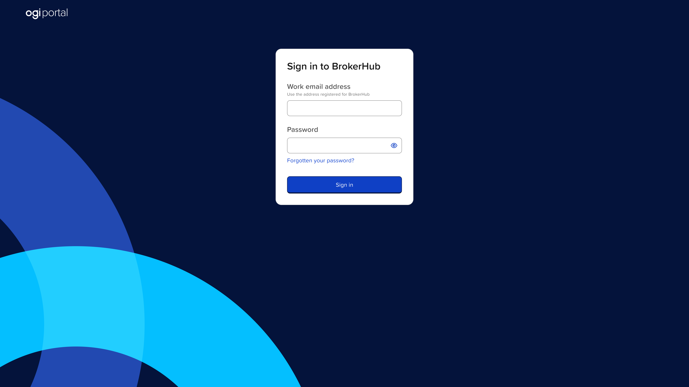
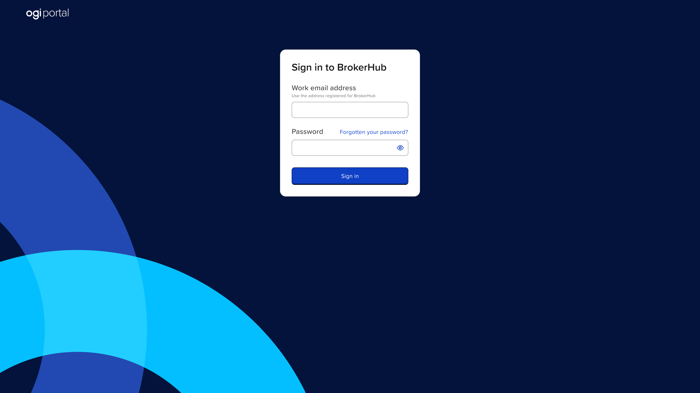
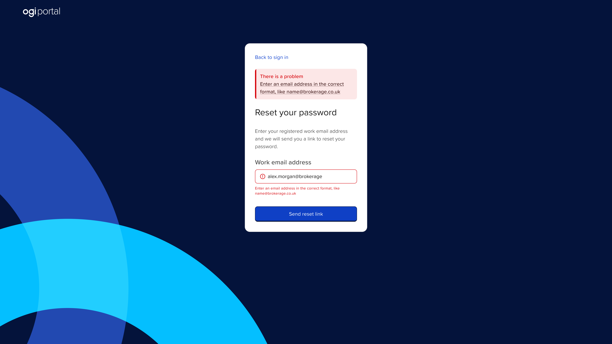
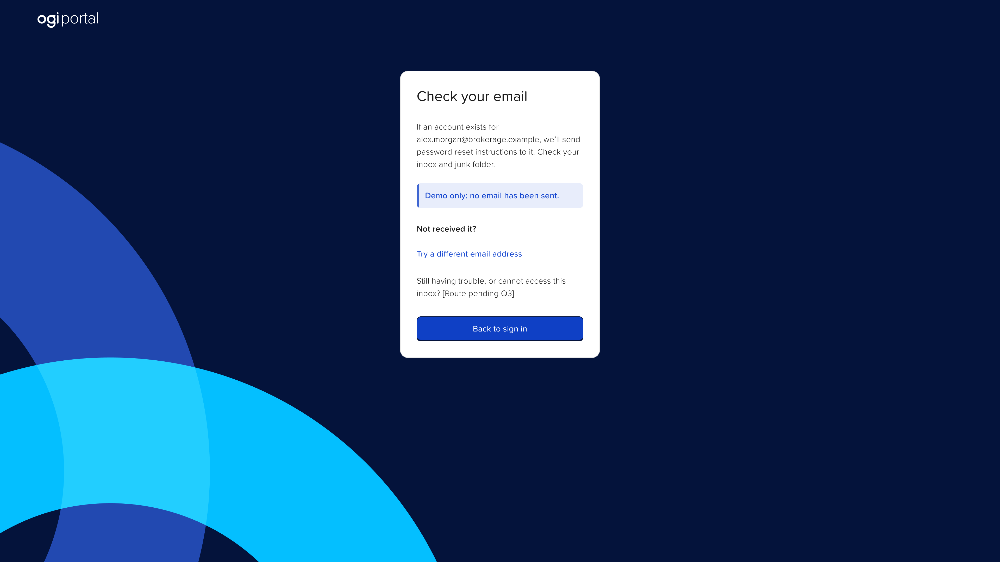
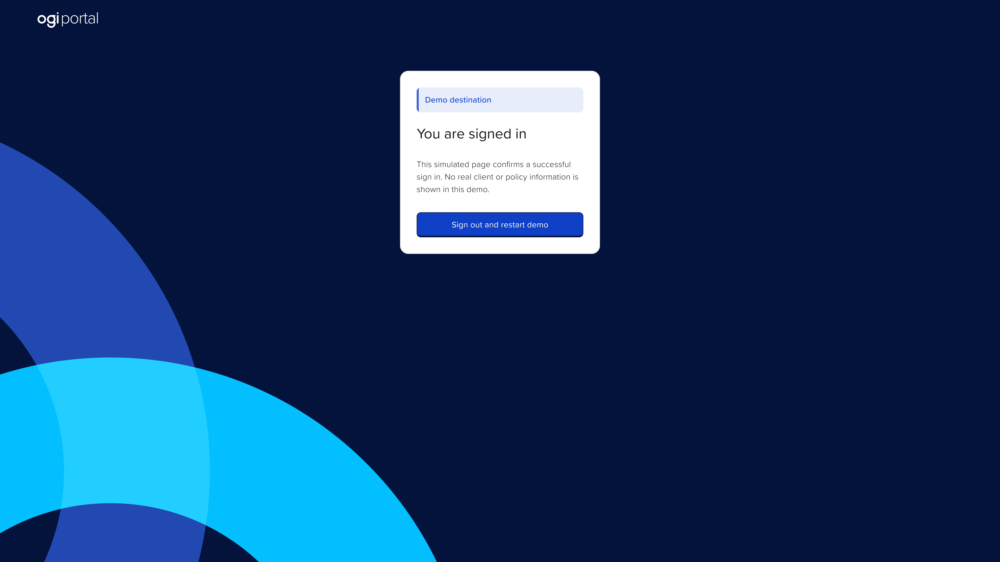

# BrokerHub login prototype build specification

**Status: draft, blocked on one decision (D13, recovery link placement).** Everything else is ready to implement.
Synthetic demo. No real customer evidence, credentials or email.

| Item | Value |
|---|---|
| Project | BrokerHub login (fictional demo) |
| Source of truth | BrokerHub login UX spec, revision 8, 24 Nov 2026: https://claude.ai/artifact/YKM6R7g3Lwgx3jcUo8uRYv |
| Figma | BrokerHub Demo, section `10:639`: https://www.figma.com/design/iv6r7ej7XnDzOSg0JTGljj/BrokerHub---Demo?node-id=10-639 |
| Review status | SCR-01 to SCR-04 reviewed in Figma by Laurence, 24 Nov 2026 (D19). Design review only, not user validation |
| Repository | https://github.com/OGI-Product-Design/buckholt-ai.git |
| Working branch | **Not supplied.** Confirm before starting |
| Destination | `/prototypes/brokerhub-login/` |
| This file's intended path | `/prototypes/brokerhub-login/prototype-build-spec.md` (not yet committed) |

## 1. Scope

**In scope:** sign in with registered work email and password; missing field, invalid email and unsuccessful sign in states; forgotten password request; neutral request confirmation; a simulated, clearly labelled success destination.

**Out of scope:** registration, multifactor authentication, single sign on, the reset journey after opening an email, real authentication, real email.

**Do not:** call any service, store credentials, send email, or reveal whether an account exists (SRC-01, REV04).

## 2. Repository instructions and design system

These could **not** be read when this file was written (no network access from the authoring environment). Read them before building and let them override anything here.

1. Repository instructions: `AGENTS.md`, `CLAUDE.md` and any Markdown guidance in `buckholt-ai`.
2. Existing prototypes in `/prototypes/` for the approved stack, file layout and run commands. **Use that stack; this file does not choose one.**
3. Buckholt HTML/CSS and AI instructions in the repository. **Buckholt is the source of truth.** Use its published components, classes and tokens. Do not create a parallel component or token library in the prototype folder.

If a Buckholt equivalent below does not exist in the repository, stop and record the gap rather than inventing markup.

### Buckholt components used in the reviewed frames

Names, variants and properties as read from the Buckholt Figma library (24 Nov 2026). Map each to its HTML/CSS equivalent in the repository.

| Role | Buckholt component and settings |
|---|---|
| Page shell | Portal header (ogi portal logo, unchanged pending Q11); portal background artwork from the existing Log in pattern |
| Container | Card, Size=Medium (384 px wide, 32 px padding, 24 px gap between items) |
| Heading | Text block, Heading size=Headline 02 |
| Body copy | `_paragraph` (left aligned) |
| Work email field | Text input, Size=Medium, Label=True, Assistive text=True (hint) |
| Password field | Text input, Size=Medium, Label=True, Trailing btn=True (Icon/Toggle/View) |
| Field error | Text input State=Error, Helper text=True (validation message), Leading Icon=True |
| Links | Standalone link, Add icon=False |
| Primary action | Button set (Alignment=Column, Top margin=True) holding Button, Style=Primary, Size=Large, Type=Text only |
| Error summary and sign in failure | Alert, State=Error, Content=True, Close button=False |
| Demo notices | Alert, State=Info, Content=False, Close button=False |

**Figma values for checking only, never to hard-code** (read from the pattern's tokens): card border `#dadada`, radius 16; form label `#454545`, 20/28; input border `#919191`, radius 8; link `#1748d0`, 16/24; primary button `#0f40c5` with `#04133b` border, 3 px bottom; text primary `#1a1a1a`; heading 28/36.

### Deviations in the Figma frames that code must NOT copy (D18)

The frames were built through a connection that could not load Buckholt fonts. In code:

- Use Buckholt typography from the repository (Proxima Soft), **not** Nunito. *Assumption: Nunito applied to the Figma build only. Confirm with Laurence if Nunito is wanted in code.*
- Use the Buckholt Alert **with** its icon. The frames omit it only because the icon font could not load.
- Field values on two frames are text overlays. In code they are ordinary input values.
- Option B's "Password" label is a local text layer. In code it must be the field's real `<label>`.

## 3. Screen inventory

| SCR | Screen | Tasks | Figma frames | States to build |
|---|---|---|---|---|
| SCR-01 | Sign in | TASK-01, 02, 03, 04, 07 | Option A `10:640`, option B `11:854`, both missing `10:1903`, unsuccessful `11:1094` | Default; email focused; email missing; password missing; both missing; invalid email; unsuccessful |
| SCR-02 | Forgotten password request | TASK-04, 07 | Default `12:1029`, invalid email `12:1196` | Default; missing email; invalid email |
| SCR-03 | Recovery request confirmation | TASK-05, 07 | `12:1331` | Single state, identical for every address |
| SCR-04 | Demo success destination | TASK-06 | `12:1433` | Single state |

States not drawn in Figma (single missing field, invalid email on SCR-01, missing email on SCR-02) reuse the drawn error pattern exactly. Their copy is given below.

### Reviewed screen images

Exports of the reviewed Figma frames, supplied by Laurence on 24 Nov 2026 (UX spec revision 7). Static snapshots: they do not update when Figma changes, so check the frame links above for the current design. They show the Figma build's Nunito text, alerts without icons and text overlays; build with the real Buckholt elements instead (section 2, D18). Images sit in `screens/` beside this file; commit them with it.

#### SCR-01 Sign in

**Default, option A: recovery link below the password field** (`10:640`)

**Default, option B: recovery link on the password label row** (`11:854`)

**Both fields missing** (`10:1903`)

**Unsuccessful attempt** (`11:1094`)

#### SCR-02 Forgotten password request

**Default** (`12:1029`)

**Invalid email** (`12:1196`)

#### SCR-03 Recovery request confirmation (`12:1331`)

#### SCR-04 Demo success destination (`12:1433`)

## 4. Blocking decision: D13 recovery link placement

Build **one** of these for SCR-01. Do not ship both.

- **Option A** (frame `10:640`): "Forgotten your password?" as a Standalone link directly below the password field. Tab order: email, password, show password, link, Sign in.
- **Option B** (frame `11:854`): the link right-aligned on the password label row, label on the left. Tab order: email, **link**, password, show password, Sign in. Keep DOM order equal to visual order; do not reorder with CSS. Buckholt support for a label-row action is unconfirmed (Q13).

Evidence: F3, F5, F6, I4, REV01. **Record the choice in the UX spec before building SCR-01.**

## 5. Per-screen specification

Copy is final unless marked. Use the typographic apostrophe (’) in displayed copy.

### SCR-01 Sign in

Order inside the card: [alert, only in error and failure states], heading, work email field, password field, recovery link (position per D13), Sign in button.

- Heading: **Sign in to BrokerHub**
- Email label: **Work email address**. Hint: **Use the address registered for BrokerHub**. `type="email"`, `autocomplete="username"`, `spellcheck="false"`.
- Password label: **Password**. `type="password"`, `autocomplete="current-password"`. Show toggle: button with accessible name **Show password** / **Hide password**, `aria-pressed` reflecting state, controls the field type.
- Link: **Forgotten your password?** goes to SCR-02.
- Button: **Sign in**.
- No registration link (D9, Q12).

**Validation on submit (client side, no request made):**

| Condition | Field message | Summary entry |
|---|---|---|
| Email empty | Enter your work email address | Enter your work email address |
| Email not in valid format | Enter an email address in the correct format, like name@brokerage.co.uk | same |
| Password empty | Enter your password | Enter your password |

Show an error Alert titled **There is a problem** listing each error as a link to its field. Fields with errors use the Text input Error state. Keep entered values. Move focus to the Alert. Prefix the document title with **Error: **.

**Unsuccessful attempt** (valid format, credentials not matching the demo account): Alert, State=Error:
- Title: **We could not sign you in**
- Body: **Check you are using your registered work email address, not a personal one, and try your password again. Not sure of your password?** followed by the link **Reset it** (to SCR-02)

Keep the email value, clear the password, mark **neither** field invalid (D7), move focus to the Alert. The same message for every failure cause (D2).

### SCR-02 Forgotten password request

Order: back link, [error Alert], heading, body, email field, button.

- Back link: **Back to sign in** goes to SCR-01 default.
- Heading: **Reset your password**
- Body: **Enter your registered work email address and we will send you a link to reset your password.**
- Field label: **Work email address**, no hint. Starts empty (assumption; carry-over from SCR-01 is open, Q9).
- Button: **Send reset link**
- Validation: as SCR-01's email rules, with the same messages and summary pattern.
- Valid format goes to SCR-03. No request is made, and nothing reveals whether the address is registered.

### SCR-03 Recovery request confirmation

Order: heading, body, demo notice, sub-heading, link, help text, button.

- Heading: **Check your email**
- Body: **If an account exists for {address}, we’ll send password reset instructions to it. Check your inbox and junk folder.** `{address}` is the value submitted on SCR-02. Wording identical for every address (REV04, D12, D15).
- Info Alert: **Demo only: no email has been sent.**
- Sub-heading: **Not received it?**
- Link: **Try a different email address** goes to SCR-02 (field empty).
- Help text, shown literally until Q3 is answered: **Still having trouble, or cannot access this inbox? [Route pending Q3]**. Do not invent a support address, phone number, resend action or timing (REV05).
- Button: **Back to sign in** goes to SCR-01 default.

### SCR-04 Demo success destination

- Info Alert: **Demo destination**
- Heading: **You are signed in**
- Body: **This simulated page confirms a successful sign in. No real client or policy information is shown in this demo.**
- Button: **Sign out and restart demo** resets all state and goes to SCR-01 default.

## 6. Behaviour matrix

| Trigger | Current state | Next state | Visible feedback |
|---|---|---|---|
| Load prototype | None | SCR-01 default | Focus on page start; heading announced |
| Submit Sign in, any required field missing or email invalid | SCR-01 | SCR-01 error | Error Alert with linked entries; fields in Error state; values kept; focus on Alert; title prefixed "Error: " |
| Activate an error summary link | SCR-01 or SCR-02 error | Same | Focus moves to the named field |
| Submit Sign in, valid format, matches demo account | SCR-01 | SCR-04 | New screen; focus on heading |
| Submit Sign in, valid format, any other combination | SCR-01 | SCR-01 unsuccessful | Failure Alert; email kept; password cleared; focus on Alert |
| Toggle show password | SCR-01 | Same | Field type and button name change; `aria-pressed` updates |
| Forgotten your password? or Reset it | SCR-01 | SCR-02 default | Focus on heading |
| Back to sign in | SCR-02 | SCR-01 default | Fields empty; focus on heading |
| Submit Send reset link, missing or invalid email | SCR-02 | SCR-02 error | As SCR-01 error pattern |
| Submit Send reset link, valid format | SCR-02 | SCR-03 | Neutral confirmation with the address; focus on heading |
| Try a different email address | SCR-03 | SCR-02 default | Field empty |
| Back to sign in | SCR-03 | SCR-01 default | Focus on heading |
| Sign out and restart demo | SCR-04 | SCR-01 default | All state cleared |

No loading state was designed. Respond immediately (assumption).

## 7. Demo data

- Demo account, fictional and configurable in one place: email `alex.morgan@brokerage.example`, password `BrokerHub-demo-1`. Show neither on screen.
- Email comparison: trim surrounding spaces and ignore case (assumption; Q5 open).
- Any address may be submitted on SCR-02; the outcome is always SCR-03.
- No persistence between sessions. Refreshing returns to SCR-01 default.

## 8. Accessibility

From SRC-01 constraints and TASK-07; to be verified, not assumed.

- Every field has a persistent visible `<label>`. Hints and errors are linked with `aria-describedby`; invalid fields carry `aria-invalid="true"`.
- Error and failure Alerts are focusable (`tabindex="-1"`), receive focus on display and are announced.
- Visible focus on every interactive element, using Buckholt's focus style.
- Keyboard-only completion of every path in section 10.
- Each screen has a unique document title and one `h1`.
- Text and controls meet the project's WCAG AA target. Check the Buckholt assistive text size and contrast for the email hint, which renders small (D18).

## 9. Responsive

Only 1920 × 1080 frames were reviewed. **Assumption, not reviewed:** keep the card centred at its Buckholt width, letting it shrink to the viewport with side margins on narrow screens, and keep the header and artwork behaviour of the existing pattern.

## 10. Acceptance checks

| Task | Check |
|---|---|
| TASK-01 | SCR-01 shows the Work email address label and one-line hint; recovery link placed per D13; matches frame `10:640` or `11:854` |
| TASK-02 | Each missing or invalid field produces its specific message and a linked summary entry; values kept |
| TASK-03 | Any non-matching attempt shows the single failure Alert; no field marked invalid; email kept, password cleared |
| TASK-04 | Recovery is reachable by keyboard from SCR-01; SCR-02 validates like SCR-01; back link works |
| TASK-05 | SCR-03 wording is identical for any address; no delivery time, expiry or resend shown; demo notice present; Q3 placeholder shown literally |
| TASK-06 | SCR-04 is labelled as a demo destination; restart clears all state |
| TASK-07 | Section 8 passes on every screen and state; no message reveals whether an account exists |

**Manual run-through:** (1) submit empty, then fix each field in turn; (2) enter `alex.morgan@brokerage` and submit; (3) enter a valid address with a wrong password; (4) sign in with the demo account and restart; (5) use the recovery link, submit invalid then valid, use both SCR-03 routes; (6) repeat 1 to 5 by keyboard only, with a screen reader for the error and confirmation states.

## 11. Assets

Use the Portal header, ogi portal logo and portal background artwork from the repository's Buckholt sources. If any is missing, leave a labelled placeholder and report it. Do not redraw or export them from Figma screenshots. No other images are used. The PNGs in `screens/` are review references only; never ship them as UI.

## 12. Open questions and known limits

| ID | Question | Effect on build |
|---|---|---|
| D13 | Option A or B for the recovery link | **Blocks SCR-01** |
| — | Working branch | Blocks committing |
| Q3 | Route for brokers who never receive the email or cannot access the inbox | SCR-03 shows a placeholder |
| Q5 | Email trimming and case | Assumption in section 7 |
| Q9 | Carry email from SCR-01 to SCR-02 | Field starts empty |
| Q11 | Header logo or BrokerHub wordmark | Logo kept |
| Q12 | Registration link | Removed |
| Q13 | Buckholt support for a label-row link | Relevant only to option B |
| Q1, Q2, Q4 | Real authentication responses, delivery policy, lockout | Not simulated; out of scope for the demo |

Known limits: repository instructions and Buckholt HTML/CSS were not read for this file; responsive behaviour is unreviewed; nothing here is validated with users.
